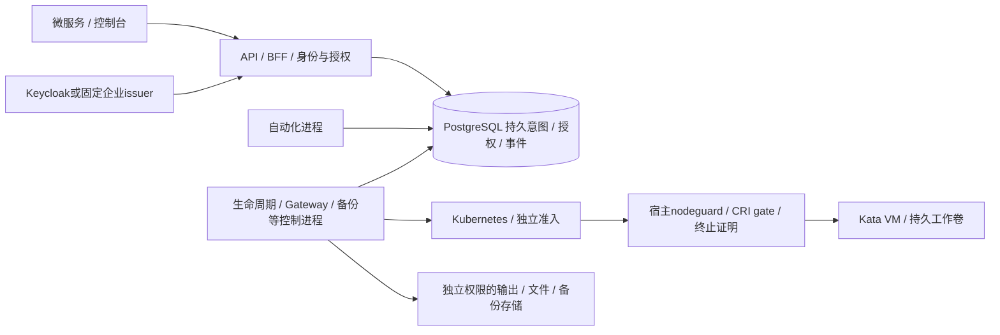

# 整仓架构检查与代码审查

审查日期：2026-10-10。固定提交：`d5f7a70afadde40e30ca01a2e9871a5312153d57`。

## 结论与范围

架构路线可以继续采用，当前版本不具备直接生产上线条件。Standards 轴确认5项代码问题；Spec 轴确认2项生产方案合同缺口。两轴分别列出，不把尚未开发或尚无实云验收的功能累计为代码漏洞。

本轮使用 mattpocock-skills 的 codebase-design 原则与 code-review 的 Standards/Spec 双轴。按用户明确选择审查当前整仓现状，不做某个历史起点到HEAD的差异审查；规范来源为用户的生产级可用要求、仓库现有合同和插件的设计原则，需求来源为[生产开发方案](rust-sandbox-production-development.md)、[54项开发表](rust-sandbox-development-workbreakdown.md)及当前功能文档。没有发现独立的 CODING_STANDARDS.md 或 CONTRIBUTING.md。

范围冻结时工作树干净，共760个公开文件，字节/模式摘要为 `6451a1b48927fd8dae5d1c1b2da205e841bafda60f5d227051408556868dcccb`。三个并行审阅分别覆盖运行时、身份与调用链、生产交付；主审复核问题的调用链和跨模块证据。审查覆盖目录与关键路径，未逐行穷尽所有760文件，不等同完整安全扫描。

优先级含义：P1需要在相应生产能力启用前修复；P2需要纳入生产交付修复，通常依赖特定故障或企业接入条件。没有报告缺乏触发证据的P0，也不据此宣称P0不存在。

## Standards：代码正确性与架构合同

### S1 / P1：自动化 worker 的节点选择与正常生产集群不相容

定位：[automation.py:65](../deploy/automation/automation.py#L65)，[cluster.py:192](../deploy/cluster/cluster.py#L192)，[data.tf:4](../infra/alicloud/data.tf#L4)。

正常自动化清单固定选择 `sandbox.platform/node-pool=control`，没有 tolerations；正常集群 inventory 的所有 control 节点带 `node-role.kubernetes.io/control-plane:NoSchedule`。按两个已交付安装模块组合部署，所有自动化副本会一直 Pending，已受理策略无人调度。现有自动化单元测试还明确断言选control，不能检出这种组合错误。

本地使用实际 `render()` 与 `inventory()` 已复现：3个被选择的control节点全部带该污点，Pod无容忍规则，结果为 `NO_TAINT_COMPATIBLE_NODE`。没有向实际集群提交资源。

单独增加容忍规则也不是完整修复：RDS的来源白名单/hostssl只来自platform子网和management，专用数据库ECS出口规则同样只给platform（[data.tf:37](../infra/alicloud/data.tf#L37)、[data.tf:74](../infra/alicloud/data.tf#L74)）。

最小修复：统一调度到可信platform池，保留control隔离及窄数据库来源；同步更新清单、测试和安装说明。新增组合验收，从正常IaC输出/inventory生成节点，再核对自动化清单确有可调度节点、跨区副本条件以及预期数据库来源。不能只做单清单schema验证。

### S2 / P1：安装器只绑定 inventory，却使用未绑定的 inputs 渲染安全策略

定位：[render.py:166](../deploy/cluster/render.py#L166)，[cluster.py:240](../deploy/cluster/cluster.py#L240)，[cluster.py:289](../deploy/cluster/cluster.py#L289)。

`generate()` 同时写 `inventory.yaml` 和 `inputs.json`，但只为inventory保存校验和。check/install/upgrade等入口核inventory后，`render()` 另读inputs，既不核它的绑定摘要，也不重新执行原业务 `validate()`。普通误改或配置同步漂移即可使审阅库存与实际渲染参数不同。

已在私有目录复现完整正常离线链：把 `inputs.json.settings.trusted_egress_cidrs` 改为 `0.0.0.0/0`，inventory及其校验和不变。原业务validator拒绝此值，但正常 `render()`、缓存Helm template、固定官方schema校验全部通过，两次均输出24个CSI资源；改后生成的trusted endpoint和host Cilium策略含world `toCIDR`。随后正常安装playbook会apply该文件（[early-policies.yaml:33](../deploy/cluster/early-policies.yaml#L33)、[addons.yaml:18](../deploy/cluster/addons.yaml#L18)）。

影响是Cilium策略层的允许范围偏离已审配置。ECS安全组仍独立限制出口；这不是已证明的所有网络层绕过或租户逃逸。复现未执行SSH、kubectl、云操作或实际apply。

最小修复：将非敏感安装输入固定为一个完整快照，inventory从该快照派生并绑定；render/check/每个执行入口核对完整摘要与一致性，再执行原业务validator。schema检查继续保留。误改inputs、替换输出、inventory与快照不匹配均应在渲染或SSH前拒绝，不能要求调用者手动记住两份配置的同步顺序。

### S3 / P1：普通输出分页在外部读取后没有复查原身份

定位：[api.rs:681](../src/api.rs#L681)，[execution_output.rs:208](../src/execution_output.rs#L208)，[db.rs:178](../src/db.rs#L178)。

`GET /v1/executions/{id}/output` 先将已验证身份减为Actor，再进行OSS读取。返回前的新事务只复查principal/租户/项目/grant，不重新解析原issuer/subject，也不检查原JWT期限。若请求开始时token有效，在对象读取期间禁用该身份映射但保留principal、membership和grant，最终检查仍通过并返回输出；原token在读取期间到期也存在相同缺口。

本地grant撤销的复查是有效的，本项没有声称完全不做撤权检查。缺的是独立身份映射与token时钟。[输出分页合同](../docs/execution-output.md#L5)要求读取期间撤权后不返回内容；metrics、文件下载和输出SSE已经在外部I/O后保留或再次核验相应身份，普通分页不一致。

最小修复：保留发起请求的身份上下文，在输出页生成后、序列化或释放内容前重核原issuer/subject、principal一致性和期限，同时保留现有最终grant检查。新增真实HTTP加延迟对象读取验收：仅禁用identity mapping，另外单独让token到期；principal/membership/grant保持有效，两种情况都不得释放内容。本项来自静态调用链，未执行新的HTTP故障注入。

### S4 / P1：生命周期 worker 在永久权限故障后仍持续运行

定位：[worker.rs:159](../src/worker.rs#L159)，[worker.rs:190](../src/worker.rs#L190)，[worker.rs:204](../src/worker.rs#L204)。

worker启动检查权限，但之后所有claim错误均进入重试，定时任务的maintain/due/accept错误也只写日志。一个具体条件是启动成功后撤销 `sandbox_due_instances(integer)` 的EXECUTE，同时保留正常operation claim权限：父进程仍能处理其他操作，但TTL/idle扫描不再获取实例；日志会记录故障，进程却不会向父监督报告致命失败。权限永久缺失或SQL/schema程序错误不能与短时依赖中断使用同一无限重试结果。

上轮自动化worker已经补致命/临时分类，此问题仍存在于生命周期worker，不能把自动化通过的进程验收外推到所有后台角色。当前worker没有提供自动化同等健康接口，本项没有声称它返回错误的ready204。

最小修复：为实际控制进程统一窄错误分类和父任务监督，永久错误取消并join有界在途任务、await池收尾后非零退出；临时错误保留原意图、退避并显式报告不可用。timer JoinHandle也应进入父任务监督，而非只在退出时等待并丢弃JoinError。各角色保留自己的账本、安全门和收尾期限。需真实进程测试启动后权限漂移及恢复，不能只验证启动拒绝。本项为静态可达性核验，未做新数据库REVOKE注入。

### S5 / P2：固定最早100项的到期扫描会使后续任务饥饿

定位：[0006_lifecycle_timers.sql:43](../migrations/0006_lifecycle_timers.sql#L43)，[worker.rs:193](../src/worker.rs#L193)，[timers.rs:23](../src/timers.rs#L23)。

扫描每轮按due_at/id固定选择最早100项，再顺序获取workspace/instance锁并受理STOP。失败只写日志，不更新该项重试资格，也没有跨批游标或独立claim。若前100项持续遇到行锁或不可处理状态，后面的正常到期项在每次扫描都不被读取；增加副本仍重复选择相同100项。仅100次原3秒锁超时就可能令单批耗时接近300秒。

影响是跨租户到期停止延迟、资源及费用占用和重复扫描负载。没有证明租户API能够制造这些锁，也不声称gateway租约校验或单写者门禁被绕过。

最小修复：在定时Module内部管理公平的有界领取/重试资格，让失败项退到其他到期项后，并让副本分工；真实compute到期时间不能被延后。也可采用有持久公平规则的有界遍历，单纯扩大LIMIT或并发执行同一批不能解决问题。验收需首100项受阻时后续正常项仍能唯一受理STOP，并保留续租/停止互斥。本项为静态反例，未实测百项锁场景。

## Spec：生产方案合同落实

### C1 / P1：细分 OAuth scope 没有与本地 grant 相交

定位：[auth.rs:365](../src/auth.rs#L365)，[api.rs:236](../src/api.rs#L236)，[db.rs:184](../src/db.rs#L184)。

原方案[第111行](rust-sandbox-production-development.md#L111)明确要求“token含细分scope时与本地grant取交集”。当前JWT验证只检查部署级required scopes，其他签名scope虽解析进VerifiedIdentity，却在大部分处理路径转换为Actor时丢失，数据库授权只看本地grant。

条件反例：主体在产品内拥有read/create，本次企业IdP发出的有效token只含 `sandbox:access instances:read` 并以此限制为只读。当前验证通过后，POST仍能使用已有create grant。此项不是无本地grant的越权，而是没有遵守已承诺的token权限上限。

默认独立Keycloak目前使用通用 `sandbox:access` profile；它没有声明细分动作scope，不能据此认定默认配置已被攻破。接企业IdP时必须明确定义scope profile/action映射，并将适用的权限上限纳入读取、写入、流和创建持久自动化委派的授权。通用profile应显式兼容，不能为修复而突然要求所有现有token增加动作scope。

最小交付验收：只读scope不能写、scope不能补足缺失grant、scope与grant都有效才允许、通用profile保持既定行为、自动化委派不能超过发起token的适用权限上限。本项是生产方案合同未落实，未执行新的签名token/HTTP复现。

### C2 / P2：SERVICE 身份没有登记或核对 client_id

定位：[service_clients.rs:41](../src/service_clients.rs#L41)，[db.rs:153](../src/db.rs#L153)。

原方案[第107—109行](rust-sandbox-production-development.md#L107)要求服务身份记录可信client_id，并核对映射后的客户端标识。[身份部署说明](../docs/identity-production.md#L90)还指导调用者登记issuer/sub/client_id。实际strict DTO只接受issuer、subject、display_name，传client_id会被拒绝；身份表和resolve_actor均只按issuer/subject，JWT中的client_id/azp只核有效形状或彼此一致，没有与登记值比较。

条件是外部IdP会把同一SERVICE subject的API token发给多个client_id，例如企业代调或token-exchange模型；不同client会继承相同产品主体的grant。默认Keycloak service-account sub由IdP按client区分，本项不构成其可被冒充的证据。

生产交付应完成SERVICE预期client绑定、轮换/迁移规则和验证，USER登录客户端保留自己的语义，不引入任意claim插件框架。在尚未实现前，外部接入支持矩阵必须明确限制为每client唯一服务subject，不能同时声称API已登记client_id。验收需相同issuer/sub但错误client_id拒绝，以及既有独立机器身份和USER流程继续通过。

## 整体架构判断与改进方向

现有主结构可保留：一个Rust代码库按权限和故障域部署多个进程；PostgreSQL持有租户状态、原幂等意图、操作领取、审计及事件；Kubernetes、准入与宿主nodeguard各自验证远端副作用。数据库claim只约束数据库进度，停止与卷复用依赖可信终止及物理事实，普通输出不被视为可信终止证明。这些分层与独立数据库角色符合当前产品目标。

该图表示代码中的责任与依赖，不认证上述组合已在实云启用。无需为了“微服务化”再拆一套分布式事务或替换持久队列。

三个优先收敛的Module：

| Module | 当前调用者承担的知识 | 应收敛的Interface与验收 |
| --- | --- | --- |
| 授权上下文 | 哪个入口需要issuer/sub、scope、client、token时钟，以及外部I/O后的最终检查 | 一次验证产生受约束上下文；最终验证有一个明确seam。避免每个处理函数自行选择要保留哪些字段；API/流/委派都通过相同合同验收 |
| 安装配置 | IaC节点池、污点、网络来源与各renderer参数，inventory/inputs双副本同步 | 完整输入快照与派生制品绑定，组合检查可调度性/网络预期。真实渲染和原validator都位于Module内部 |
| 控制进程监督 | 永久/临时错误、关键子任务状态、退避、停止与池收尾 | 共享窄监督合同；各领域仍自行持有claim、幂等和物理关闭逻辑。测试实际进程的错误/恢复/退出，不引入通用工作流引擎 |

这三处有多个真实调用者，收敛能获得Locality；不建议按文件长度大拆模块、把所有SQL泛化为repository trait，或为尚无第二个adapter的云能力预建抽象工厂。先通过真实interface验收，再替换仅断言内部形状的重复测试。

## 独立的生产发布阻断

以下是已明确的功能/环境缺口，不计入上述代码问题数量：

- 正式恢复仍为 `cfg(test)` 私有实现，生产API/供应商gate/原子发布及实云恢复验收未完成；0038永久保留，不能为上线填占位迁移。
- 全产品安装入口尚未组合：云管理LB固定platform ECS:32443，但现有API/console/identity清单主要为ClusterIP，仓库未交付相应完整NodePort/产品路由安装合同。
- 集群安装仍主动保留Kata quarantine与启用门禁；真实Kata/Cilium/CSI、旧节点fencing、备份在失去原盘后的恢复等必须通过同一候选验收。
- 当前源码的Linux八ELF、OCI/SBOM/新鲜扫描与统一签名发布闭包，生产身份/PKI/HA、总数据库连接预算、升级/灾备及72小时容量还没有完整通过证据。

不能通过增加容忍污点、扩大网段、关闭安全门或把历史本地测试当作当前云认证消除这些阻断。

## 验证与证据

本轮未执行Cargo、Docker、数据库故障注入、SSH、云操作或完整安全扫描，也未修改实现源码。完成了两个部署问题的纯本地复现，其中S2运行正常renderer、缓存Helm template及固定官方schema。离线渲染在新增磁盘缓存指令到达前完成；后续任何编译/测试/打包/隔离验证遵守新的df预检及缓存规则。本报告与私有记录存放在构建缓存之外。

证据路径：

- 范围冻结记录（本机验收证据，不随源码发布）。
- 交付时源码一致性记录（本机验收证据，不随源码发布），核对原760文件字节与模式、HEAD及本轮唯一新增报告。
- 运行时审阅（本机验收证据，不随源码发布）。
- 身份与调用链审阅（本机验收证据，不随源码发布）。
- 交付审阅（本机验收证据，不随源码发布）。
- 调度组合复现（本机验收证据，不随源码发布）。
- 正常离线渲染复现（本机验收证据，不随源码发布），SHA256 `ce0364b521d00339646cab32888e7965880da90cf8bb40d69cdc7598d6492cae`。

S2的inventory前后SHA256相同为 `aa40ae241a380a2c421eb8167430e3e4607a315de226fff1399aa9f06b3eeb31`；inputs从 `784846169fd90cb60be45b2a74153df9ca2e633b12369560bec589c4c066a1ce` 改为 `5d289e7589da9c27222a2bda1081090ed9ef8c081f96430dad6064c6f15bf78f`；实际policy从 `7d5b49c837b997ec28c682e48f960ab55bfcb40fe43c05b7da2be78686f16b71` 改为 `b4ae9b8d7043120d625a72f4f45a265c10132bc36a3bddf8ef92de6e7462200e`。两份策略均通过schema，这说明schema通过不能代替业务约束与配置绑定。

Standards：5项，最高P1，涉及部署不可调度、安装漂移、输出身份复查和后台故障监督；Spec：2项，最高P1，为细分scope权限交集。后续修复分别按对应合同验收，再推进完整生产发布。
