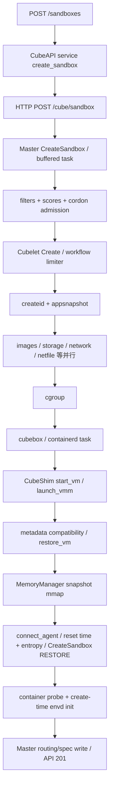

# CubeSandbox 启动、资源效率与 GPU：固定源码证据调查

日期：2026-10-13。固定版本：`897def3abf1ad9b5df3d42fd4893d38c41ccabd9`。采用 REA 的检查项、入口→状态→结果、事实/推断/缺失证据分层方法；目标有完整源码，使用正常仓库检索与调用链调查，不运行外部逆向 provider 或安装脚本。本报告仅阅读官方仓库代码和作者发布的 benchmark，未在 KVM/GPU 机器上复现，未调用托管服务或开通云资源。下载的文本源码经根任务逐个 Git blob 校验；二进制、媒体、子模块内容不在源码调查边界内。

## 1. 结论与证据等级

Cube 的快路径是“事先把可用系统启动成模板，再恢复到新的独立 MicroVM”，不是每次从 OCI 拉取、解包并完整冷启动 Linux。磁盘通过 XFS reflink 共享 extents；当前 XFS 内存恢复直接对同一个模板/快照文件建立 `MAP_PRIVATE`，读页面共享、写页面变成私有。TAP 与 cgroup 对象预建；模板本地性过滤、分阶段并行创建、吞吐限流减少在线关键路径。这些机制有源码支撑，但源码不能证明某个部署上的 P99 或单位成本。

[模板与恢复机制](https://github.com/TencentCloud/CubeSandbox/blob/897def3abf1ad9b5df3d42fd4893d38c41ccabd9/docs/architecture/overview.md#L148-L157) [XFS 原始快照映射](https://github.com/TencentCloud/CubeSandbox/blob/897def3abf1ad9b5df3d42fd4893d38c41ccabd9/Cubelet/storage/local.go#L990-L1000) [内存快路径](https://github.com/TencentCloud/CubeSandbox/blob/897def3abf1ad9b5df3d42fd4893d38c41ccabd9/hypervisor/vmm/src/memory_manager.rs#L1326-L1386)

| 检查项 | 官方主张 | 固定源码/报告证据 | 判断 |
|---|---|---|---|
| 启动延迟 | README `<60ms`，50 并发平均 67ms/P95 90ms/P99 137ms | 官方细化报告裸金属单并发平均 47.8ms；50 并发平均 276.1ms/P95 508.4ms；测量前预热、本地已构建模板 | 两份官方结果口径/版本未完全对齐；本次无独立复现，不承诺 60ms |
| 内存开销 | README `<5MB` | 官方密度报告 1000 个 2vCPU/2GiB 的 create-only 沙箱，宿主增量摊销约 25.7MB/VM | `<5MB` 不能作为节点总成本；共享基线、宿主池和实际工作集必须计入 |
| 密度/利用率 | 千实例/宿主 | 官方报告测试的是 idle/light-load；满写 2GiB 估算仅约 185 个，且无 CPU 满负载吞吐保证 | 低占用、高装箱密度与高实际资源利用率是不同指标 |
| GPU | 可运行 CUDA 的隔离 VM 与 GPU 调度 | README 和 roadmap 明确列 Coming soon；底层继承的 VFIO/NVIDIA 测试是原语，不是产品 GPU 完整链路 | 未证实 Cube 已交付 GPU 共享、配额、租户计量、清理与恢复 |

[README 性能主张](https://github.com/TencentCloud/CubeSandbox/blob/897def3abf1ad9b5df3d42fd4893d38c41ccabd9/README.md#L231-L244) [裸金属报告条件及结果](https://github.com/TencentCloud/CubeSandbox/blob/897def3abf1ad9b5df3d42fd4893d38c41ccabd9/docs/blog/posts/2026-06-01-cubesandbox-perf-benchmark.md#L72-L89) [并发结果](https://github.com/TencentCloud/CubeSandbox/blob/897def3abf1ad9b5df3d42fd4893d38c41ccabd9/docs/blog/posts/2026-06-01-cubesandbox-perf-benchmark.md#L160-L172) [密度及满载估算](https://github.com/TencentCloud/CubeSandbox/blob/897def3abf1ad9b5df3d42fd4893d38c41ccabd9/docs/blog/posts/2026-06-01-cubesandbox-perf-benchmark.md#L234-L264) [GPU roadmap](https://github.com/TencentCloud/CubeSandbox/blob/897def3abf1ad9b5df3d42fd4893d38c41ccabd9/README.md#L410-L422)

报告标题把 template create 称为 cold-start；实验实际先构建模板，并丢弃预热轮，排除 page-cache 冷读噪音。不能将这个数字用于首次镜像下载/模板构建、新节点首次启动、跨节点首次 S3 恢复或首个 CUDA kernel。报告脚本使用 `latest` 镜像，文章也没有为所有数据附运行二进制 SHA、不可变镜像 digest 和原始逐请求样本；本文固定源码用于解释机制，不能反推该源码版本必然复现文章结果。

[实验镜像、模板创建与预热](https://github.com/TencentCloud/CubeSandbox/blob/897def3abf1ad9b5df3d42fd4893d38c41ccabd9/docs/blog/posts/2026-06-01-cubesandbox-perf-benchmark.md#L44-L89)

PVM 报告是另一环境：16 核/32GiB 的腾讯云 CVM、专用 PVM 内核；单并发平均 66.7ms/P95 78.2ms，20 并发平均 364.6ms/P95 521.4ms。它表明硬件与并发对延迟的影响很大，不能把裸金属值带入阿里云节点，也不能认为通用云 VM 都具备相同 KVM/PVM 条件。

[PVM 环境](https://github.com/TencentCloud/CubeSandbox/blob/897def3abf1ad9b5df3d42fd4893d38c41ccabd9/docs/blog/posts/2026-06-03-cubesandbox-perf-benchmark-pvm.md#L29-L42) [PVM 实验结果](https://github.com/TencentCloud/CubeSandbox/blob/897def3abf1ad9b5df3d42fd4893d38c41ccabd9/docs/blog/posts/2026-06-03-cubesandbox-perf-benchmark-pvm.md#L154-L168)

## 2. create → resource → restore → ready 的真实调用链

以下是固定 SHA 的实际源码链。官方 architecture 图把 API→Master 画作 gRPC，但当前 Rust client 用 HTTP `POST /cube/sandbox`，应按源码为准。配置决定插件组合，不存在“API 已返回就等于任意业务代码可用”的普适保证。

1. `handlers::create_sandbox` 等待 service 后返回 201；service 构造请求并等待 Master；`CubeMasterClient::create_sandbox` 是 reqwest HTTP，而不是仅内存分配或预创建句柄。[API 入口](https://github.com/TencentCloud/CubeSandbox/blob/897def3abf1ad9b5df3d42fd4893d38c41ccabd9/CubeAPI/src/handlers/sandboxes.rs#L180-L209) [service 等待后端](https://github.com/TencentCloud/CubeSandbox/blob/897def3abf1ad9b5df3d42fd4893d38c41ccabd9/CubeAPI/src/services/sandboxes.rs#L262-L306) [HTTP Master client](https://github.com/TencentCloud/CubeSandbox/blob/897def3abf1ad9b5df3d42fd4893d38c41ccabd9/CubeAPI/src/cubemaster/mod.rs#L59-L73)

2. `CreateSandbox` 入缓冲队列并等待 done；`handleCubelet` 执行调度、最终重新检查 cordon、向 Cubelet 发起 create，维护节点本地创建并发计数。节点选择经过 filters/scorers 后从前 N 个候选选取。[Master 创建与等待](https://github.com/TencentCloud/CubeSandbox/blob/897def3abf1ad9b5df3d42fd4893d38c41ccabd9/CubeMaster/pkg/service/sandbox/sandbox_run.go#L105-L247) [Cubelet dispatch](https://github.com/TencentCloud/CubeSandbox/blob/897def3abf1ad9b5df3d42fd4893d38c41ccabd9/CubeMaster/pkg/service/sandbox/sandbox_run.go#L278-L301) [调度器](https://github.com/TencentCloud/CubeSandbox/blob/897def3abf1ad9b5df3d42fd4893d38c41ccabd9/CubeMaster/pkg/scheduler/schedule.go#L28-L56)

3. 默认 Cubelet create concurrency=100。阶段内工作并行，阶段间有顺序：createid/apps​​napshot → images/volume/storage/network/netfile/store → cgroup → cubebox。`Engine::run` 先 TryAcquire、每个 step 等待完成、出错补偿；这不是无限并发。[默认 workflow](https://github.com/TencentCloud/CubeSandbox/blob/897def3abf1ad9b5df3d42fd4893d38c41ccabd9/Cubelet/config/config.toml#L190-L200) [限流与分阶段执行](https://github.com/TencentCloud/CubeSandbox/blob/897def3abf1ad9b5df3d42fd4893d38c41ccabd9/Cubelet/plugins/workflow/engine.go#L398-L455)

4. `appsnapshotCompleter::Create` 确保目标 run template 在本机、必要时使用运行快照元数据 fallback；storage 同时准备卷与解析最新 memory volume 路径。XFS rootfs `CreateSandboxRootfsFromTemplate` → `RollbackDeriveNewGen` → `CreateSnapshotFromVolume` → `ficlone`，最后落到 `ioctl(FICLONE)`，避免完整复制模板磁盘。[本机模板确保](https://github.com/TencentCloud/CubeSandbox/blob/897def3abf1ad9b5df3d42fd4893d38c41ccabd9/Cubelet/plugins/cube/internals/appsnapshot/appsnapshot_plugin.go#L54-L103) [storage 并行](https://github.com/TencentCloud/CubeSandbox/blob/897def3abf1ad9b5df3d42fd4893d38c41ccabd9/Cubelet/storage/local.go#L878-L903) [rootfs 派生](https://github.com/TencentCloud/CubeSandbox/blob/897def3abf1ad9b5df3d42fd4893d38c41ccabd9/Cubelet/storage/cubecow_volume_manager.go#L139-L160) [FICLONE 实际调用](https://github.com/TencentCloud/CubeSandbox/blob/897def3abf1ad9b5df3d42fd4893d38c41ccabd9/cubecow/src/engine/reflink.rs#L1079-L1100)

5. `SandBox::start_vm` 先创建 VMM。符合 snapshot 路径时调用 restore；要求应用快照恢复的请求失败后直接返回错误，不能偷偷降为 cold boot。普通路径恢复失败可 fallback boot。`restore_vm` 验证 CPU/内存规格、内核、OS/agent版本和设备元数据，重建网络/磁盘/vsock配置，再调用 Hypervisor VmRestore。[选择恢复/冷启与 ready事件](https://github.com/TencentCloud/CubeSandbox/blob/897def3abf1ad9b5df3d42fd4893d38c41ccabd9/CubeShim/shim/src/sandbox/sb.rs#L871-L945) [兼容性与设备重建](https://github.com/TencentCloud/CubeSandbox/blob/897def3abf1ad9b5df3d42fd4893d38c41ccabd9/CubeShim/shim/src/sandbox/sb.rs#L947-L1012)

6. application snapshot 成功恢复可提前结束 start_vm 的事件等待，但后续仍要 connect_agent；恢复后重新设置时钟、重灌随机数种子，并向 guest agent 发 RESTORE 模式 CreateSandbox。Cubelet 的容器启动之后执行 configured probe 和 create-time envd 初始化，再结束 create。因此需要同时测 API reply、agent ready、业务首成功三个时间点。[guest 时间与随机数](https://github.com/TencentCloud/CubeSandbox/blob/897def3abf1ad9b5df3d42fd4893d38c41ccabd9/CubeShim/shim/src/sandbox/sb.rs#L449-L491) [agent ready 与 RESTORE初始化](https://github.com/TencentCloud/CubeSandbox/blob/897def3abf1ad9b5df3d42fd4893d38c41ccabd9/CubeShim/shim/src/sandbox/sb.rs#L493-L559) [probe 与 envd init](https://github.com/TencentCloud/CubeSandbox/blob/897def3abf1ad9b5df3d42fd4893d38c41ccabd9/Cubelet/services/cubebox/cube_container_create.go#L433-L473)

## 3. 为什么资源小：不是跨租户共用一个正在运行的 guest kernel

同模板内存的快恢复有可验证前提：`!config.exist_shared()` 且无 virtio-mem hotplug。满足时直接打开 snapshot memory 文件，把它传入恢复的 RAM 区域；`create_ram_region` 使用 `MAP_NORESERVE | MAP_PRIVATE`，只有 prefault=true 才 `MAP_POPULATE`。不满足则 `fill_saved_regions` 填充，进入慢恢复。源码里的 KSM/MADV_MERGEABLE 是另一可配置机制，不能仅因 README 写 kernel sharing 就认定跨租户启用了 KSM。每个 VM 的 vCPU、guest 内核状态与写页面仍独立；这里主要共享的是只读模板/快照页面。

[fast/slow eligibility](https://github.com/TencentCloud/CubeSandbox/blob/897def3abf1ad9b5df3d42fd4893d38c41ccabd9/hypervisor/vmm/src/memory_manager.rs#L1326-L1386) [mmap flags](https://github.com/TencentCloud/CubeSandbox/blob/897def3abf1ad9b5df3d42fd4893d38c41ccabd9/hypervisor/vmm/src/memory_manager.rs#L1506-L1545) [prefault默认禁用](https://github.com/TencentCloud/CubeSandbox/blob/897def3abf1ad9b5df3d42fd4893d38c41ccabd9/hypervisor/vmm/src/config.rs#L2142-L2145) [可选 KSM 标记](https://github.com/TencentCloud/CubeSandbox/blob/897def3abf1ad9b5df3d42fd4893d38c41ccabd9/hypervisor/vmm/src/memory_manager.rs#L1842-L1866)

当前 XFS 的 `prefetchRestoreMemoryVolURL` 特别强调直接 mmap 原始 snapshot 文件；S3 同节点 pause-resume 需要独立内存卷，防止 package NVMe deactivate 影响运行 VM，跨节点 import 也有独立卷。文档概括的“rootfs 与 memory 都 clone”并不能精确描述这三个分支。共享页越多越省，写入/匿名页越多，节省越少；CoW 不减少执行用户代码本身需要的 CPU。

[实际 XFS/S3 分支](https://github.com/TencentCloud/CubeSandbox/blob/897def3abf1ad9b5df3d42fd4893d38c41ccabd9/Cubelet/storage/local.go#L975-L1070)

已有 snapshot commit 的层次也比“总是增量”复杂：优先 reflink 最近快照并写 soft-dirty delta；最近基线缺失则从 last-restore 基线写全部当前匿名 CoW 页面；再尝试 S3 自有恢复卷，最后 fresh volume/full snapshot。soft-dirty 内核探测或 clear_refs 失败会回退 pagemap_anon。Pause 当前代码选择 incremental 或 full，不是文章预期的“80–90% 更快”已经量化验收。历史 pause 报告的 558.4ms 和未来约60ms预测，不能充当当前 fixed SHA 结果。

[commit基线与fallback](https://github.com/TencentCloud/CubeSandbox/blob/897def3abf1ad9b5df3d42fd4893d38c41ccabd9/Cubelet/services/cubebox/snapshot_base_memory.go#L330-L446) [soft-dirty降级](https://github.com/TencentCloud/CubeSandbox/blob/897def3abf1ad9b5df3d42fd4893d38c41ccabd9/hypervisor/vmm/src/memory_manager.rs#L2478-L2496) [Pause实际选择](https://github.com/TencentCloud/CubeSandbox/blob/897def3abf1ad9b5df3d42fd4893d38c41ccabd9/Cubelet/services/cubebox/snapshot_base_memory.go#L249-L321) [历史pause数据与预测](https://github.com/TencentCloud/CubeSandbox/blob/897def3abf1ad9b5df3d42fd4893d38c41ccabd9/docs/blog/posts/2026-06-01-cubesandbox-perf-benchmark.md#L470-L514)

## 4. 高密度的预付成本、调度和生命周期

TAP 池预创建、默认拒绝策略下进入 Ready；Ready→Active→Cleaning→Ready 严格限制复用，旧 owner 未清理不能重新分配。池保存空闲 fd，命中后省去 TUNSETIFF/重新 attach；启动时后台预热，缺货会同步创建。这意味着“池命中快”和“节点刚启动/池耗尽快”是两项 SLA，网络内核对象、IP范围、fd/eBPF状态都要计入节点成本。默认 TAP=500，cgroup pool_size=3000，cgroup 也创建 NUMA cpuset 及子组，不能算成每实例零成本。

[TAP 状态与复用](https://github.com/TencentCloud/CubeSandbox/blob/897def3abf1ad9b5df3d42fd4893d38c41ccabd9/Cubelet/network/runtime/tap_pool.go#L15-L156) [fd复用](https://github.com/TencentCloud/CubeSandbox/blob/897def3abf1ad9b5df3d42fd4893d38c41ccabd9/Cubelet/network/runtime/tap_lifecycle.go#L45-L86) [预热与缺货](https://github.com/TencentCloud/CubeSandbox/blob/897def3abf1ad9b5df3d42fd4893d38c41ccabd9/Cubelet/network/runtime/tap_lifecycle.go#L383-L418) [Acquire冷创建](https://github.com/TencentCloud/CubeSandbox/blob/897def3abf1ad9b5df3d42fd4893d38c41ccabd9/Cubelet/network/runtime/controller.go#L806-L850) [默认池规模](https://github.com/TencentCloud/CubeSandbox/blob/897def3abf1ad9b5df3d42fd4893d38c41ccabd9/Cubelet/config/config.toml#L58-L84) [NUMA cgroup预建](https://github.com/TencentCloud/CubeSandbox/blob/897def3abf1ad9b5df3d42fd4893d38c41ccabd9/Cubelet/plugins/cube/internals/cgroup/pool.go#L187-L206)

S3 恢复采用按需块读取与本地缓存：overlay/zero range 优先、不可变 UUID 对应缓存命中跳过 S3；miss 合并并发 GET，失败走精确 range GET。RAM缓存、磁盘缓存和对象存储费用显式存在，进程重启 RAM index 变冷。官方 S3 README 明示默认每 lvstore 1024×1MiB、MAP_POPULATE，即约1GiB resident RAM缓存；默认单 WAL/cache 镜像布局512GiB。这个存储层的驻留与 S3 request/transfer 成本不能与 `<5MB/VM` 混算。首次访问延迟会被搬到恢复后的 page fault/I/O，API快并不消灭 I/O。

[cache miss→GET](https://github.com/TencentCloud/CubeSandbox/blob/897def3abf1ad9b5df3d42fd4893d38c41ccabd9/CubeS3lvol/lib/s3bsdev/s3_bs_dev.c#L1305-L1350) [range GET](https://github.com/TencentCloud/CubeSandbox/blob/897def3abf1ad9b5df3d42fd4893d38c41ccabd9/CubeS3lvol/lib/s3bsdev/s3_bs_dev.c#L687-L700) [缓存语义与冷重启](https://github.com/TencentCloud/CubeSandbox/blob/897def3abf1ad9b5df3d42fd4893d38c41ccabd9/CubeS3lvol/include/s3lvol/s3_cache.h#L8-L83) [RAM驻留预算](https://github.com/TencentCloud/CubeSandbox/blob/897def3abf1ad9b5df3d42fd4893d38c41ccabd9/CubeS3lvol/README.md#L383-L391) [默认磁盘布局](https://github.com/TencentCloud/CubeSandbox/blob/897def3abf1ad9b5df3d42fd4893d38c41ccabd9/CubeS3lvol/README.md#L89-L94)

调度并非单一“空闲就塞”：模板必须本地或明确 AllowNonLocalTemplate；CPU filter 同时看可用 quota 和节点 CpuUtil，memory filter 同时看 allocated quota 与实际剩余 RAM、保留空间。`EffectiveAllocated` 默认使用已分配记录，配置可明确忽略 Redis allocation。节点默认资源派生（仅无显式 quota/有效 fallback 时）CPU可达物理核×2，内存 quota可达检测值×5/4，这是资源承诺超配，不是硬件扩容，不应抄成所有企业租户默认。

[本地模板条件](https://github.com/TencentCloud/CubeSandbox/blob/897def3abf1ad9b5df3d42fd4893d38c41ccabd9/CubeMaster/pkg/selector/filter/template_locality.go#L31-L66) [CPU双检查](https://github.com/TencentCloud/CubeSandbox/blob/897def3abf1ad9b5df3d42fd4893d38c41ccabd9/CubeMaster/pkg/selector/filter/cpufilter.go#L32-L56) [内存双检查](https://github.com/TencentCloud/CubeSandbox/blob/897def3abf1ad9b5df3d42fd4893d38c41ccabd9/CubeMaster/pkg/selector/filter/memfilter.go#L32-L60) [allocated默认语义](https://github.com/TencentCloud/CubeSandbox/blob/897def3abf1ad9b5df3d42fd4893d38c41ccabd9/CubeMaster/pkg/base/config/config.go#L322-L347) [fallback超配常量](https://github.com/TencentCloud/CubeSandbox/blob/897def3abf1ad9b5df3d42fd4893d38c41ccabd9/Cubelet/pkg/cubelet/node_status.go#L38-L43) [quota派生](https://github.com/TencentCloud/CubeSandbox/blob/897def3abf1ad9b5df3d42fd4893d38c41ccabd9/Cubelet/pkg/cubelet/node_status.go#L651-L700)

自动暂停用 CLM 的代理活动时间/CreatedAt 与 timeout 判断，保护启动回填窗口、Leader 与并发状态；不是基于 GPU utilization 或 CPU零使用。PauseToSnapshot 冻结/保存后删除 MicroVM，Cubelet 清理 shim，之后恢复是从 snapshot重新 create。默认 `paused_resource_release_ratio=0` 在物理 RAM已回收时仍保留完整调度quota；改成1允许最大密度但恢复best-effort，0~1保留部分headroom。实际 `aggregateSandboxResources` 按(1-ratio)计暂停CPU/RAM，磁盘继续计量；`admitResume` 承认并发是乐观检查而非原子 reservation。因此我们应借鉴暂停持久化和配额语义，另做严格容量预留，不能照搬“保证恢复”的措辞。

[idle决策](https://github.com/TencentCloud/CubeSandbox/blob/897def3abf1ad9b5df3d42fd4893d38c41ccabd9/cube-lifecycle-manager/internal/sweeper/sweeper.go#L108-L199) [暂停删除VM](https://github.com/TencentCloud/CubeSandbox/blob/897def3abf1ad9b5df3d42fd4893d38c41ccabd9/CubeShim/shim/src/sandbox/sb.rs#L1536-L1617) [暂停quota策略](https://github.com/TencentCloud/CubeSandbox/blob/897def3abf1ad9b5df3d42fd4893d38c41ccabd9/Cubelet/pkg/config/config.go#L50-L71) [实际计量](https://github.com/TencentCloud/CubeSandbox/blob/897def3abf1ad9b5df3d42fd4893d38c41ccabd9/Cubelet/services/cubebox/metric.go#L175-L230) [并发恢复限制](https://github.com/TencentCloud/CubeSandbox/blob/897def3abf1ad9b5df3d42fd4893d38c41ccabd9/Cubelet/services/cubebox/update.go#L255-L323)

## 5. GPU：查到了什么，没有查到什么

| 证据类别 | 固定源码事实 | 不能推出的结论 |
|---|---|---|
| 产品能力声明 | Coming soon GPU Sandboxes，目标host GPU passthrough与GPU-aware scheduling | GPU已可生产开通；已有MIG/time-slicing/MPS策略 |
| VMM原语 | fork内有generic VFIO设备路径、NVIDIA Tesla T4 deviceQuery/DCGM测试和PCI hotplug场景 | CubeAPI→Master→Cubelet完整GPU生命周期已实现/验收 |
| API/调度 | current RequestResource为CPU/Memory/SystemDisk/Template；GPU标签/CDI字符串例子和节点DeviceClass测试存在 | 标签等于GPU库存/可抢占租约；CDI等于VM设备隔离；整卡能原子分配 |
| 快照 | generic VFIO snapshot保存PCI/config/interrupt等结构 | CUDA context、VRAM、在途DMA、driver状态可恢复，跨节点GPU可迁移 |
| 利用率与清理 | 本次在Cube产品层没有找到MIG/time-slicing/MPS、DCGM租户采样、显存擦除/设备reset→健康检查→释放完整链路 | 未检索命中等于绝对不存在商业实现；底层测试即多租户保障 |

[产品 GPU roadmap](https://github.com/TencentCloud/CubeSandbox/blob/897def3abf1ad9b5df3d42fd4893d38c41ccabd9/docs/guide/roadmap.md#L5-L33) [generic VFIO文档](https://github.com/TencentCloud/CubeSandbox/blob/897def3abf1ad9b5df3d42fd4893d38c41ccabd9/hypervisor/docs/vfio.md#L67-L94) [T4测试验证内容](https://github.com/TencentCloud/CubeSandbox/blob/897def3abf1ad9b5df3d42fd4893d38c41ccabd9/hypervisor/test_infra/src/lib.rs#L1200-L1215) [NVIDIA inherited integration cases](https://github.com/TencentCloud/CubeSandbox/blob/897def3abf1ad9b5df3d42fd4893d38c41ccabd9/hypervisor/tests/integration.rs#L10219-L10317) [调度资源类型](https://github.com/TencentCloud/CubeSandbox/blob/897def3abf1ad9b5df3d42fd4893d38c41ccabd9/CubeMaster/pkg/scheduler/selctx/selectcontext.go#L35-L55) [VFIO wrapper snapshot](https://github.com/TencentCloud/CubeSandbox/blob/897def3abf1ad9b5df3d42fd4893d38c41ccabd9/hypervisor/pci/src/vfio.rs#L1690-L1720)

负检索边界：检查 CubeAPI/CubeMaster/Cubelet/CubeOps、agent、hypervisor、cubecow、部署与docs中 `.rs/.go/.proto/.yaml/.toml/.md` 的 `GPU/CUDA/NVIDIA/MIG/time-slicing/MPS/DCGM/VFIO/CDI`。结果包含 roadmap、通用继承代码、测试标签、windows设备测试、CDI注释；没有查到贯穿产品创建请求→库存→租约→attach→利用率归属→清理回收的 GPU 实现。本次没有执行 GPU integration tests，也没有读取 binary/media 或外部私有实现，因此结论限定于该SHA公开文本源码。

CPU内存的MAP_PRIVATE CoW不会共享模型在显存中的权重或CUDA context。GPU快照需要GPU/驱动明确支持设备状态保存恢复；其设备占用会产生与CPU沙箱不同的生命周期约束。作为我们产品设计，第一版GPU应明确禁止把带GPU运行实例套入当前CPU pause/clone/restore快路径，返回能力不支持，提供应用checkpoint→释放→重建；等设备/驱动矩阵有真实验收才开通能力。这里是对Knotsandbox的方案判断，不是Cube现有行为声明。

## 6. 对 Knotsandbox 的落地顺序

以下是基于调查提出的开发/验收要求，不代表本轮已经实现，避免用宣传延迟直接替换我们现有生产约束。

| 优先级 | 需要落地的设计 | 生产验收证据 |
|---|---|---|
| P0 测量口径 | create API、scheduler queue、template resolve、image准备、storage clone、network池命中、VMM、agent、业务首成功各段；使用单调时钟并记录deployment/source/image digest；独立cold/warm/local/remote/pool-miss维度 | 固定机型与节点池的逐请求样本、p50/p95/p99/max、错误率；首业务结果的校验而不是仅201；压测预热成本和CPU/RAM/IO全账 |
| P1 模板快启 | 模板生命周期独立：build→boot→app probe→quiesce→snapshot→compat validation→publish→node cache→GC；模板仅含允许共享的无租户秘密基线；签名/digest与发行版安全快照一致 | clean-node、cache-cold、cache-hot、compat mismatch、template删除/损坏/secret扫描；恢复重置entropy/time/实例身份/网络；现有Kata/QEMU执行栈需能力适配证明，不能仅换VMM宣称ready |
| P1 CoW+缓存 | 先固定可支持的filesystem/快照格式，用标准reflink或运行时原生snapshot；模板read-only reference持有至所有恢复者结束；memory快启须实际核对私有映射与fault行为 | 多实例写隔离、缓存污染、CoW写放大、page-cache residency、磁盘ENOSPC、断电恢复/GC、多kernel/runtime组合；完整负载含真实Python/browser工作集 |
| P1 配额与预付资源 | admitted request、host硬limit、observed usage、shared cache、idle pools分开；所有pending create/resume用持久原子reservation与epoch；保守tenant保障类与超配batch类明确区分 | 100个并发reservation不超承诺，OOM/throttling可归属，节点离线/请求超时/cleanup quarantine仍占位；CPU满负载、RAM满写、FD/IP/TAP/eBPF耗尽矩阵 |
| P2 空闲回收 | 基于活跃执行、长连接、周期任务、I/O和用户lease决定idle；持久pause快照与恢复headroom；可调策略需预览/审计/rollback | 空闲API但后台忙的反例不暂停、并发wake、断流、快照失败、capacity不足、跨AZ数据源故障与恢复测试；给出最低空闲时长与存储/恢复盈亏点 |
| P2 GPU独立链路 | host GPU inventory/UUID/IOMMU组/driver能力矩阵→原子租约→supported runtime attach→tenant指标→detach/reset+健康诊断→归还或quarantine；GPU默认exclusive | 两租户冲突拒绝、设备ID不会泄漏、GPU进程退出/非法DMA/驱动reset失败/显存残留实机验收；CPU/RAM释放不能提前释放GPU租约 |
| P3 GPU效率 | 先采集allocated vs used、SM active、VRAM、memory BW、功耗/PCIe、kernel/队列等待、idle占租时长；再在明确可信边界里评估MIG/共享服务/批处理/模型常驻 | 整卡与每GPU instance归属真实匹配、低SM但高带宽不误判idle、MIG碎片/重配置/容量保障/租户隔离、首kernel latency与GPU小时成本；time-slicing/MPS不能仅凭提高 utilization作为非可信租户准入理由 |

测量应输出两个成本：每请求/任务的工作成本与满足延迟SLO的待命成本。模板、pagecache、pool、RAM缓存、对象存储、控制面、遥测和故障headroom全部计入；只算VMM私有RSS或每批wall/N会夸大改善。优化项目按“基线→原因→改动→同负载A/B→容量/隔离回归→灰度→回滚”交付。我们可实现同类快路径，具体做到多少毫秒/每节点多少实例必须以我们固定部署测量为准。
