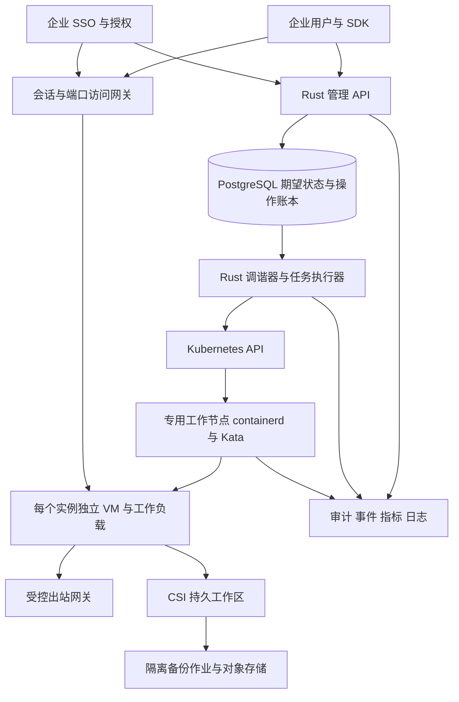

# Rust 企业多租户沙箱平台预研方案

本方案评估使用 Rust 开发企业多租户沙箱平台的可行性，覆盖实例详情、监控、操作记录、事件、安全防护、健康诊断、定时与自动化任务、备份，以及所有能力的开放 API。参考对象为 OpenSandbox、腾讯 CubeSandbox 和阿里云 ECS 及其配套服务。用户已确认场景为企业多租户、执行非可信代码。

**结论：有条件可行，建议进入有明确验收门槛的技术验证。推荐用 Rust 开发产品控制面，以 Kubernetes、containerd 和 Kata Containers 作为首选运行底座，复用成熟存储与可观测组件。** 项目的主要难点是隔离、状态收敛、数据恢复和持续运维，不是 Rust 能否实现管理页面与 HTTP API。

调研日期为 2026 年 10 月 3 日。本文是基于官方文档和发布记录的预研，尚未完成目标云环境上的性能、安全或容灾实测。下文性能、规模、工期与成本均为设计目标或估算，不能视为已经验证的承诺。

## 1 产品范围与生产边界

产品定义为“面向企业的安全执行环境和实例运维平台”：提供容器镜像和文件工作区的使用方式，通过独立虚拟机内核运行不可信工作负载，并提供类似 ECS 的管理体验。对外实例 ID 稳定，底层 Pod、IP 和节点可以变化。

以下是本次估算的暂定条件，只有多租户与非可信代码已由用户确认。其余条件会影响报价和技术选型，但不影响先完成预研。

| 项目 | 本方案暂定条件 |
| --- | --- |
| 工作负载 | Linux x86_64，Python、Node.js、编译任务、浏览器自动化，无 GPU |
| 持久化 | 工作区长期保留；操作系统和工具链通过版本化镜像重建 |
| 部署环境 | 一个地域，具备 KVM 的专用工作节点；控制组件具备跨故障域部署条件 |
| 容量基线 | 1000 个并发运行实例，默认规格 1 vCPU、2 GiB 内存、20 GiB 工作区；仅用于测算 |
| 使用入口 | 企业 SSO、Web 控制台、REST API、Python 与 TypeScript SDK |
| 第一生产版 | 八项管理能力全部可用，具备租户隔离、HA、恢复验证、升级回滚和运维手册 |

第一生产版支持停止后保留工作区、重建运行环境、快照、独立备份和恢复。**任意进程内存恢复、在线迁移、GPU、Windows、任意特权容器不进入默认承诺。** 如果这些是硬要求，应在技术验证前改变运行时选择和预算，不能用界面上的“暂停”“备份”掩盖底层能力缺失。

Rust 用于自研服务、控制器、CLI 和必要的执行协议组件；Kubernetes、数据库、CNI、存储驱动可以采用其原生实现。Web 前端建议 TypeScript。要求全部依赖也重写成 Rust，会增加交付风险，且对本项目目标没有必要收益。

## 2 参考项目的真实能力与复用价值

| 参考对象 | 已核实事实 | 本项目应借鉴的内容 |
| --- | --- | --- |
| OpenSandbox | 已发布统一版本 1.1.0，包含 FastSandbox Firecracker 集成、PostgreSQL 快照元数据存储、诊断与指标改进；运行时能力存在差异 | 生命周期与执行数据面分离，API 契约、SDK、模板和运行时适配边界 |
| CubeSandbox | 基于 RustVMM/KVM；v0.7.2 README 仍将 Kubernetes 部署和跨节点快照恢复标为 preview | 模板预热、快照克隆、休眠与恢复、出站安全代理；作为运行底座候选 |
| 阿里云 ECS 及配套服务 | 管理体验由计算、监控、审计、安全、自动化与备份产品共同构成 | 实例详情组织、操作闭环、状态解释、证据链和恢复流程 |

阿里云的具体分工包括 CloudMonitor 监控、ActionTrail 审计、云助手命令执行、OOS 编排以及独立安全和备份服务。借鉴的是管理闭环，本项目不会因此默认获得这些服务的保障。[ECS 监控与日志](https://www.alibabacloud.com/help/en/ecs/user-guide/monitoring-and-logging)、[OOS 管理 ECS](https://www.alibabacloud.com/help/en/ecs/user-guide/overview-3)、[应用安全](https://www.alibabacloud.com/help/en/ecs/user-guide/application-security)、[备份与容灾](https://www.alibabacloud.com/help/en/ecs/user-guide/disaster-recovery-solutions)

OpenSandbox 的上述版本能力来自 [1.1.0 发布记录](https://github.com/opensandbox-group/OpenSandbox/releases/tag/release-1.1.0)。其当前 API 文档明确，诊断接口提供尽力而为的日志和事件描述，并不定义结构化审计或完整可观测模型，因此仍需建设本平台的审计与运维数据体系。[OpenSandbox API 文档](https://github.com/opensandbox-group/OpenSandbox/blob/main/docs/api/index.md)

版本采用还有一个已知风险：1.1.1-rc.1 发布说明修复了 1.1.0 PyPI server wheel 的导入失败，并将 agent-sandbox provider 的暂停恢复及共享 Namespace 租户隔离列为新增能力。因此不能把这些 RC 能力算入 1.1.0，也不能建议安装该稳定包后直接上线；需对固定产物完成部署与安全回归，等待或自行维护经验证的修复版本。[OpenSandbox 1.1.1 RC 发布说明](https://github.com/opensandbox-group/OpenSandbox/releases/tag/release-1.1.1-rc.1)

CubeSandbox 的版本边界见 [v0.7.2 README](https://github.com/TencentCloud/CubeSandbox/blob/v0.7.2/README.md)。它并非全 Rust 系统：官方架构包含 Rust、Go、OpenResty/Lua 组件。复用时应保留组件边界，通过适配器接入，避免为了统一语言维护大规模分叉。[CubeSandbox 架构](https://github.com/TencentCloud/CubeSandbox/blob/master/docs/architecture/overview.md)

CubeSandbox v0.7.2 发布记录列出增量快照数据丢失、模板删除影响既有快照、ARM 恢复等问题的修复。这些记录应转化为本项目的回归用例，不能据此断言当前版本仍有相同缺陷。官方启动速度和额外内存指标也不能代替本项目在真实镜像、存储、并发和故障条件下的测量。[CubeSandbox v0.7.2 发布记录](https://github.com/TencentCloud/CubeSandbox/releases/tag/v0.7.2)

**成熟度判断：两者都值得参考或复用，但不能仅根据开源、厂商品牌或演示结果，就认定已经满足本项目完整的企业生产要求。** 采用前必须锁定 release、提交、镜像 digest、内核和驱动版本；主线文档与预发布能力只作为线索。两项目根许可证为 Apache 2.0，复制代码前仍需核对锁定版本及其依赖、镜像和修改文件的许可证与通知义务。[OpenSandbox LICENSE](https://github.com/opensandbox-group/OpenSandbox/blob/main/LICENSE)、[CubeSandbox LICENSE](https://github.com/TencentCloud/CubeSandbox/blob/v0.7.2/LICENSE)

## 3 技术路线与选型结论

下表为针对本需求的工程判断，不是官方性能排名。

| 路线 | 收益 | 主要代价与边界 | 结论 |
| --- | --- | --- | --- |
| Rust 控制面加 Kubernetes 和 Kata | OCI、调度、CSI、网络策略和运维工具可复用；工作负载使用独立内核 | 需要验证 KVM、Kata、CNI、CSI 的完整组合；不天然提供通用内存快照 | **默认首选** |
| Rust 产品层加 CubeSandbox | 快照、克隆和 Agent 执行路径更贴近专用沙箱 | 部分能力处于 preview；需要独立验证故障恢复、升级、存储一致性和租户隔离 | 快速休眠与克隆成为核心需求时优先对照验证 |
| Rust 产品层加 OpenSandbox | 可复用协议、SDK 和执行能力，缩短基础接入工作 | 保留 Python/Go 等组件；需明确本平台和 OpenSandbox 的状态所有权 | 已决定采用其 SDK 生态时有价值 |
| Kubernetes 加 gVisor | 用户态内核提供额外隔离，可适配部分没有 KVM 的场景 | 系统调用、文件 IO、浏览器和特定工具兼容性要实测；不能宣称硬件虚拟化隔离 | 独立产品规格的备选 |
| 直接基于 Firecracker 自建全部编排 | 专用运行路径可高度定制 | 网络、镜像转换、节点管理、存储、快照兼容和调度都需自己承担 | 当前需求不建议 |
| 普通 runc 加 Namespace | 接入简单 | 共享宿主内核，不作为本场景默认信任边界 | 不用于非可信租户池 |

Kubernetes 官方将虚拟机和用户态内核列为沙箱隔离方式，说明 Namespace、配额和访问控制需要组合使用；Namespace 本身不等于完整的恶意多租户隔离。[Kubernetes 多租户文档](https://kubernetes.io/docs/concepts/security/multi-tenancy/)

**运行时选择规则：**首选路线必须通过第四周验收。若目标机型没有可用 KVM，先调整节点采购或验证另一种明确标注的隔离规格；Kata 启动失败时禁止自动退回 runc。若硬要求是保存任意进程内存和亚秒级恢复，应把 CubeSandbox 与其他 MicroVM 方案放到同一测试矩阵重新决策，不能假设通用 Kubernetes 操作就能提供。

一期只维护一个生产运行时。内部适配接口保留能力查询，例如 `persistent_workspace`、`disk_snapshot`、`memory_checkpoint`、`cross_node_restore`；不支持的操作返回明确错误。避免同时建设三套控制器、三套网络和三套存储语义。

## 4 推荐架构与 Rust 实现边界



管理 API 负责鉴权、授权、参数校验、配额预留和记录用户意图；长任务提交后返回操作 ID。会话网关承载终端、文件传输、命令输出和端口代理，避免长连接与大文件拖垮管理 API。调谐器持续比较期望状态与实际状态，执行可以重试的步骤。

一个实例对应一个 Kata Pod/VM 隔离单元，不把不同租户放入同一 Pod。租户/项目 Namespace 承担资源与权限分组；高保障租户另提供专属节点池或集群。调度优先级和租户公平排队由产品层决定，节点放置交给 Kubernetes；产品层与 Kubernetes 配额同时约束，避免并发创建突破上限。

首版采用一个 Rust workspace、清晰模块边界和三个主要部署角色：`api`、`reconciler-worker`、`session-gateway`。定时、诊断、备份编排先作为 worker 模块，真正执行镜像构建和备份导出的作业使用隔离资源池。无需一开始拆成十余个微服务。

| 组件 | 推荐实现 | 关键约束 |
| --- | --- | --- |
| API 与协议 | Tokio、Axum、Tower；统一 OpenAPI 契约 | 版本化接口、超时、背压、限流、流量上限 |
| Kubernetes 接入 | kube-rs，watch 加定期全量校验 | 处理 watch 断连、资源版本变化和重复事件 |
| 状态与任务账本 | PostgreSQL、SQLx、显式迁移 | 事务 outbox、唯一约束、租约和 fencing token |
| 会话服务 | Rust 网关，复用成熟 TLS 与 HTTP 代理组件 | WebSocket/SSE 流控，短期凭证，长连接重连 |
| 指标与日志 | 优先接入企业现有托管服务；自托管基线为 Prometheus、Thanos、Loki 与 Collector | 租户过滤、序列预算、限额、采集失败可见 |
| 身份与密钥 | 企业 OIDC，对接 KMS 或现有 Secret Manager | 不自行实现认证协议或密码学 |
| 存储 | 目标云已支持的 CSI 块存储与对象存储 | 独立生命周期、加密、备份和恢复验证 |

Axum 提供 HTTP 路由与 Tower 集成，kube-rs 提供 Controller、watcher 等基础组件，SQLx 可连接 PostgreSQL；这些能支持技术实现，但不自动提供业务状态一致性。[Axum](https://docs.rs/axum/latest/axum/)、[kube-rs runtime](https://docs.rs/kube/latest/kube/runtime/index.html)、[SQLx](https://github.com/transact-rs/sqlx)

调研时 OpenTelemetry Rust 官方仍将主要信号列为 Beta。建议把接入封装在内部模块，锁版本并验证导出链路，核心审计独立持久化，不能让遥测 SDK 的升级或故障影响操作事实。[OpenTelemetry Rust 状态](https://opentelemetry.io/docs/languages/rust/)

## 5 八项管理能力的生产定义

| 能力 | 控制台和 API 提供什么 | 后端实现与验收要点 |
| --- | --- | --- |
| 实例详情 | ID、名称、项目、地域、规格、镜像 digest、运行状态、健康状态、工作区、端点、TTL、策略版本和备份情况 | 区分期望状态、观测状态、最后观测时间；节点等内部信息仅运维角色可见；无采集时显示未知 |
| 监控 | CPU 使用与限流、内存、OOM、磁盘容量与 inode、IO、网络、连接数、启动耗时和实例可用性 | 从宿主/运行时采集可信资源指标；应用指标标注来源；按实例 ID 查询历史；告警有确认、恢复和静默 |
| 操作记录 | 谁在何时对哪个资源做了什么、来源、参数摘要、授权结果、操作 ID、最终结果 | 持久审计和操作账本，脱敏、追加写、归档与防篡改；API 和控制台走同一条路径 |
| 事件 | 调度失败、拉镜像失败、OOM、探针失败、节点失联、策略阻断、备份失败、平台维护 | 标准事件类型、严重程度、首次/最近发生、次数、原因、建议动作；不只依赖短期 Kubernetes Event |
| 安全防护 | 网络访问策略、身份权限、镜像检查、密钥引用、资源限制、安全告警与隔离动作 | 在运行时外强制执行；配置必须有生效版本和时间；隔离后撤销会话与出站权限 |
| 健康诊断 | 基础设施、运行环境、应用三层诊断及证据报告 | 规则版本、数据时间、置信范围、证据引用、处理建议；明确“未知”和“无法检查” |
| 定时与自动化 | 定时启停、备份、诊断、模板命令、告警触发任务、执行历史 | 持久调度、时区、漏跑策略、并发策略、重试、截止时间、授权校验和熔断 |
| 备份 | 手工/自动备份、保留策略、恢复到新实例、跨故障域副本、恢复演练结果 | 明确备份范围、一致性级别、完整性和可恢复状态；失败重试、恢复校验与删除保护 |

详情页建议设为上述八个页签，并在顶部始终显示实例状态、数据新鲜度、关键告警和正在进行的操作。页面不显示一个没有依据的“健康分”；例如“运行中，但工作区仅剩 3%，最近备份失败”比笼统的绿色状态更有价值。

控制台、CLI 和 SDK 复用同一 API；不允许只有 UI 才能执行的关键运维动作。租户看到自身资源和脱敏事件，运维角色通过独立权限查看底层证据。

## 6 生命周期和分布式一致性

### 状态语义

| 操作或状态 | 本平台保证 | 不包含的隐含保证 |
| --- | --- | --- |
| 创建和启动 | 镜像、工作区、策略和应用就绪检查全部通过后进入 Running | Pod 已调度不等于实例可用 |
| 停止 Stopped | 释放计算资源，保留声明的持久卷和实例配置 | 内存、临时目录和容器可写层不保证保留 |
| 重启 | 保留工作区，重建执行环境；重启前可配置备份 | 不保证原进程、终端连接或 IP 保持 |
| 休眠 Hibernated | 仅在已验收运行时提供内存和磁盘检查点 | 冻结进程不等于释放内存，也不等于可迁移 |
| 删除 | 撤销端点与权限，清理计算资源，按显式策略保留或删除卷 | 不默认级联删除所有历史备份 |
| Unknown 或 Recovering | 明确标记观测丢失或恢复中，附原因和时间 | 节点失联不能直接当成已经停止 |

模型保留 `desired_state`、`observed_state`、`generation`、`observed_generation`、`conditions`、`last_observed_at`。健康状态独立于生命周期；备份、诊断等进度放在 Operation 中，避免把所有组合塞进一个巨大状态枚举。

### 唯一事实来源与调谐流程

PostgreSQL 是租户、实例期望配置、配额、策略、Operation 和审计的唯一业务事实来源。Kubernetes 保存运行资源和观测结果，指标库保存历史测量。若使用 Sandbox CRD，它只是由业务数据库派生的执行投影；禁止 API 和控制器分别维护两份可独立修改的期望状态。

创建流程为：鉴权和授权 → 同一数据库事务内写实例、配额预留、Operation、审计与 outbox → 返回 202 → worker 领取任务 → 按实例 ID 和 generation 创建确定命名的资源 → 检查持久卷、隔离、网络策略及应用 readiness → 提交观测状态与完成事件。

关键失败处理如下。

| 故障 | 处理规则 |
| --- | --- |
| 客户端超时后重发 | 同一租户、接口和 Idempotency-Key 返回同一个操作；请求体不同则拒绝 |
| Pod 已创建但数据库尚未记成功 | 通过资源标签和确定名称重新发现，继续原操作，不新建第二份 |
| worker 崩溃或租约到期 | 新 worker 接管；数据库 CAS 拒绝旧提交，外部副作用按接收端支持的前置条件与幂等能力处理 |
| 数据库不可用 | 暂停新的管理写入；已有工作负载按既有策略运行；不能假报成功 |
| watch 中断或事件丢失 | 自动重连并定期全量对账，发现孤儿资源和状态漂移 |
| 删除与备份、重启冲突 | 以实例 generation 和操作互斥规则裁决，返回明确冲突或进入排队 |
| 节点网络分区 | 撤销可达入口，标记 Unknown；先证明旧节点无法继续写盘，再转移有状态负载 |

worker 通过持久任务领取与实例级租约分配执行权；通用 watch 调谐使用明确分片或 leader 选举。增加副本数不能自动消除竞争，必须验证失租约后停止提交和故障接管。[kube-rs 可用性说明](https://kube.rs/controllers/availability/)

fencing token 只有被实际副作用接收端校验才有作用。Kubernetes 更新/删除使用 resourceVersion、UID 前置条件，并结合实例 generation、确定名称、owner 引用和删除墓碑防止旧操作覆盖新状态；节点执行接口校验递增 epoch。对于不支持 fencing 的云 API，使用提供商幂等键和结果查询；结果未知时冻结冲突操作并对账，不能仅因租约超时就并发重发有副作用请求。数据库锁不能取消已经在途的外部操作。

节点重调度尤其不能只依赖租约或 RWO 卷标记。需落实云主机停机/电源 fencing、存储侧隔离和单写者 generation 检查；租约不是物理 IO 隔离。Kubernetes 官方明确说明，非正常关机时错误的强制 detach 可能导致数据损坏。[节点关闭与卷解绑](https://kubernetes.io/docs/concepts/cluster-administration/node-shutdown/)

对于用户脚本访问外部系统产生的副作用，本平台无法保证“恰好一次”。恢复过程中不能无条件重跑支付、发信或数据库修改等命令；调用方需提供业务幂等键，非幂等任务进入结果待确认状态。

## 7 多租户安全设计

安全目标是限制恶意工作负载的权限、传播范围和资源消耗。Rust 降低部分内存安全风险，但不能替代虚拟化边界、访问控制或漏洞响应。

| 边界 | 必须落地的控制 |
| --- | --- |
| 身份与租户 | OIDC、项目级 RBAC、服务账号 scope；tenant_id 从已认证身份推导；所有查询、日志、指标、备份、会话与下载都进行租户授权 |
| 运行时 | 专用 Kata 工作节点；强制 runtimeClass；拒绝租户修改 hostNetwork、hostPID、hostPath、privileged、设备与宿主 socket 挂载 |
| 资源 | CPU、内存、PID、临时盘、inode、日志、网络连接、出口带宽、并发命令和 API 请求配额；限制镜像解压与压缩包处理 |
| 网络 | 默认拒绝跨实例和跨租户访问；批准后开放端点；屏蔽节点管理口、控制面、云元数据和链路本地地址；同时覆盖 IPv4/IPv6 |
| 出站 | 通过受控 DNS 和出站网关实施允许列表；关闭可绕过的直连路径；验证 DNS rebinding、重定向、代理、DoH/QUIC 与私网地址 |
| 凭据 | KMS 加密、短时凭证和权限收敛；模型或第三方长期密钥尽量由外部代理注入；镜像、日志、快照不嵌入长期密钥 |
| 供应链 | 镜像固定 digest、来源与签名校验、漏洞准入、SBOM；构建非可信镜像使用隔离构建池；内核和运行时可追踪升级 |
| 应急隔离 | 在沙箱外撤销入口和出站权限，保留证据；受控终止/恢复；break-glass 管理访问具有时限与完整审计 |

Cilium 可以实现 DNS、端口和部分 L7 策略；本方案将其作为候选网络组件，仍需验证与 Kata 数据路径和宿主防火墙的组合。域名解析后的 IP 允许列表并不等同于 HTTP 身份验证，敏感第三方 API 应通过真正校验目标的代理访问。[Cilium DNS 策略](https://docs.cilium.io/en/stable/security/dns/)

用户命令执行器与诊断程序如果和租户工作负载处在同一个可控制环境，就必须视为可篡改数据源。计费、隔离、权限和安全结论不能只相信它们的上报。Kata 自身的 kata-agent 则属于运行时可信计算基，官方将其与 guest 内工作负载的容器环境区分；仍需按 guest 可能失陷的模型约束宿主接口。[Kata 架构](https://github.com/kata-containers/kata-containers/blob/main/docs/design/architecture/README.md)

Web 端点使用与管理控制台分离的域名和 Cookie 边界，避免不可信页面读取管理会话。WebSocket 校验 Origin 和授权，文件 API 防路径穿越、符号链接逃逸和覆盖；上传大小和终端输出有硬上限。所有 webhook URL 在平台外联边界校验，防止通知功能成为 SSRF 通道。

运行时监控也有边界：宿主 eBPF 可以观察 VMM 及网络活动，不能据此宣称已经审计 guest 内全部系统调用。需要更深行为分析时，定义 guest 采集的可信程度，或引入专门的运行时检测方案并验证成本。

## 8 存储和备份恢复

### 必须分开的四种数据

| 数据 | 默认处理 | 恢复含义 |
| --- | --- | --- |
| 镜像和模板 | OCI 仓库固定 digest，保留构建描述与签名 | 重建工具链和系统环境 |
| 持久工作区 | 独立 CSI 卷，生命周期不依赖 Pod | 文件和应用数据继续存在 |
| 磁盘快照与独立备份 | CSI 快照用于快速恢复；独立备份导出到隔离对象存储 | 快照依赖存储后端，备份承担误删与故障域恢复 |
| 进程内存与 VM 状态 | 默认不承诺；支持时有单独兼容矩阵 | 检查点恢复，不等于跨内核/跨 CPU 的通用迁移 |

容器根文件系统默认可重建，用户持久修改放入 `/workspace` 或通过模板构建固化。若要求像 ECS 一样任意修改系统盘并在重启后保留，必须新增“持久系统盘实例”规格并验证对应运行时，不能悄悄把临时可写层当成系统盘。

备份记录必须包含镜像 digest、实例配置版本、卷清单、数据时间点、一致性级别、校验结果、加密密钥引用和恢复依赖；不保存可直接使用的长期明文凭据。模板和基线数据有引用计数，仍被备份引用时不可物理删除。

备份数据搬运优先验证 Velero CSI Snapshot Data Movement，复用其数据传输与恢复机制，Rust 负责产品策略和任务编排。该机制将快照数据写入备份存储，仍需要匹配的 CSI、目标 StorageClass 与权限配置；实施时锁定版本和对象存储插件。导出源使用快照派生的临时卷，明确 mover 的节点拓扑和权限，在平台受控环境执行，租户不可获取备份凭据。[Velero 数据搬运](https://velero.io/docs/v1.18/csi-snapshot-data-movement/)、[CSI 快照支持](https://velero.io/docs/v1.18/csi/)

### 一致性与恢复流程

崩溃一致性只保证类似突然断电后的磁盘状态；文件系统一致性需要刷写与冻结；应用一致性依赖应用自身的 flush、checkpoint、dump 或备份协议。数据库场景需单独的备份适配，不把普通卷快照宣传成数据库一致性保障。

推荐流程为：确定范围和策略 → 获取实例操作锁 → 执行有超时的应用准备动作 → 触发快照 → 无论成功失败均执行解冻/清理 → 从快照创建隔离的只读导出源 → 导出到对象存储 → 校验 manifest 和数据完整性 → 标记备份状态 → 定期恢复演练。应用准备失败时，按策略使任务失败，或明确降级到崩溃一致性并记录，禁止静默降级。

冻结动作必须具有最大 TTL、独立 watchdog 和可接管的持久补偿记录，覆盖 worker 崩溃或网络分区；不能只依靠正常函数退出时解冻。API 同时返回 `required_consistency`、`achieved_consistency` 和降级原因。任意租户 hook 返回成功不证明应用一致性，只有经过应用恢复验证的适配器才能获得相应保证。阿里云的应用一致性快照也依赖应用准备脚本，并明确自定义脚本需要自行保证正确性。[应用一致性快照](https://www.alibabacloud.com/help/en/ecs/user-guide/create-application-consistent-snapshots-in-the-ecs-console/)

第一版默认单持久工作卷；多卷仅在所选存储的快照组与应用协议通过验收后开放一致恢复点，不能把顺序创建的若干快照当作同一时间点。

恢复默认创建新实例和新卷，先在隔离网络校验文件、应用启动及访问权限，再由已授权操作切换端点；不直接覆盖运行中的原实例。恢复中的工作负载不得自动对外执行历史任务。

对恢复保证分别定义：工作区卷自身耐久性、备份的 RPO、恢复单个实例的 RTO、控制数据库恢复、整可用区恢复。区域型存储与可用区型存储的能力不同；跨区复制和备用计算容量未准备好时，不承诺自动跨区恢复。

建议保留策略作为可配置默认值：日备份 7 份、周备份 4 份、月备份 3 份；重要租户单独约定更短 RPO、对象锁和跨故障域副本。备份凭据、删除权限和主运行环境分离；每月抽样恢复，并在存储或运行时重大升级前完成一次恢复验证。

RPO 按“当前时间减去最近已验证可恢复备份的数据时间点”监控，不能按最近启动任务时间计算。调度间隔需给备份耗时与失败重试留余量，超过目标立即告警；有一份标记成功的旧备份不代表当前仍满足 RPO。RTO 从发起恢复到数据和应用校验完成计算。

## 9 API 和数据契约

API 前缀为 `/v1`，控制台完全使用公开或同契约的管理 API。以下是拟定资源面，不是已经实现的接口。

| API | 用途 |
| --- | --- |
| `POST /instances`、`GET /instances`、`GET /instances/{id}` | 创建、列表、详情 |
| `PATCH /instances/{id}`、`DELETE /instances/{id}` | 允许字段更新、按删除策略销毁 |
| `POST /instances/{id}/actions/start`、`stop`、`restart` | 异步生命周期操作，具体路径均以 actions 为前缀 |
| `POST /instances/{id}/executions` | 执行受授权命令，返回执行 ID |
| `POST /instances/{id}/sessions` | 创建终端、文件或端口访问的短期会话 |
| `GET /executions/{id}`、`GET /executions/{id}/output` | 查询退出码与有游标的输出 |
| `GET /operations/{id}`、`POST /operations/{id}/cancel` | 查询长任务；按阶段支持尽力取消 |
| `GET /instances/{id}/metrics`、`logs`、`events` | 有时间范围、分页/游标和查询限制的观测接口 |
| `GET /audit-events` | 按身份、资源、操作和时间检索审计 |
| `GET/PUT /instances/{id}/security-policy` | 查询与更新安全策略，返回应用状态 |
| `POST /instances/{id}/diagnoses`、`GET /diagnoses/{id}` | 触发诊断、获取证据报告 |
| `POST/GET /schedules`、`PATCH/DELETE /schedules/{id}` | 管理定时任务及版本 |
| `POST/GET /automation-rules`、`GET /task-runs` | 管理事件自动化、查询执行历史 |
| `POST /instances/{id}/backups`、`GET /backups` | 创建和查询备份 |
| `POST /backups/{id}/restores` | 恢复到新实例 |
| `POST/GET /backup-policies`、`PATCH /backup-policies/{id}` | 管理备份计划与保留策略 |
| `GET /capabilities`、`GET /quotas`、`GET /usage` | 查询运行时支持项、资源配额和用量 |
| `POST/GET /webhook-subscriptions` | 订阅可重试的事件通知 |

示例只展示提交与异步回执，鉴权由真实请求的服务账号完成。

```http
POST /v1/instances
Authorization: Bearer <scoped-token>
Idempotency-Key: 8c53e75d-2cb0-4fa5-9d43-241d3135f414
Content-Type: application/json

{
  "name": "agent-workspace-01",
  "project_id": "prj_123",
  "template_id": "tpl_python_approved",
  "flavor": "cpu1-mem2",
  "workspace": {"size_gib": 20, "retention": "retain"},
  "security_policy_id": "sec_restricted_01"
}
```

```json
{
  "instance_id": "ins_01",
  "operation_id": "op_01",
  "desired_state": "running",
  "observed_state": "pending"
}
```

返回 `202 Accepted` 和 Operation 地址，不能把请求已接受显示为实例已经启动。所有变更产生可追踪的 Operation；更新使用 ETag/If-Match 或等价版本检查；幂等记录保存期覆盖客户端重试窗口。错误响应包含稳定的 `code`、`request_id`、是否可重试和必要的字段错误。配额耗尽、无容量、状态冲突与运行时不支持必须区分。

SDK 生成基础客户端后补齐认证、重试、轮询、流式输出与取消逻辑，并有契约测试。提供 OpenAPI、API 示例、版本兼容与废弃政策。可选 E2B/OpenSandbox 协议适配放在边界层，明确已验证子集，不宣称全协议无差别兼容。

核心数据实体为 Tenant、Project、Principal、Instance、Volume、TemplateVersion、Operation、Execution、AuditEvent、DomainEvent、SecurityPolicyVersion、Diagnosis、Schedule、TaskRun、Backup、Restore、QuotaReservation 和 UsageRecord。它们是领域边界，不要求一开始全部独立成服务。

## 10 审计 事件 诊断与自动化闭环

审计记录“谁做了什么”，Operation 记录“平台操作执行到哪一步”，领域事件记录“系统发生了什么”，执行日志记录“程序输出了什么”。四者用 request_id、operation_id、instance_id 关联，分别设置访问权限与保留期限。

租户可修改的日志不能充当权威审计。管理变更的受理审计与操作记录在同一事务提交；后续结果追加记录。拒绝的请求也记录到受保护的审计通道。应用角色不能修改历史审计，归档到独立权限的对象存储；跨域复制有延迟时，明确归档 RPO。高风险管理操作在审计不可持久化时失败关闭。

事件采用带版本的稳定 schema，包含 event_id、tenant_id、resource_id、type、reason、severity、occurred_at、observed_at 和 operation_id。Webhook 采用签名、过期时间、防重放、退避重试和失败队列，消费者按 event_id 去重；不承诺全局严格有序。

健康诊断第一版使用确定性规则，例如镜像拉取失败、无匹配节点、卷挂载失败、OOM、磁盘/inode 不足、DNS 失败、证书过期和最近备份过期。每条结论附证据和采集时间；大模型可以帮助解释报告，但不单独决定重启、删除或放开网络。

这借鉴了 ECS 将诊断视为可跟踪任务并返回检查结果和建议的方式，具体规则与授权范围由本平台重新定义。[ECS 综合诊断](https://www.alibabacloud.com/help/en/ecs/user-guide/diagnose-the-health-status-of-an-instance)

自动化使用同一操作引擎，不绕过授权。采用 PostgreSQL 持久调度和领取租约，以 `schedule_id + schedule_version + scheduled_at` 唯一约束防重复创建 TaskRun；扫描补偿漏跑，区分跳过、补跑一次和有限追赶。支持 IANA 时区、夏令时策略、并发禁止/排队、最大运行时长、冷却期与每日动作预算。

外部动作仍按至少一次投递和业务幂等设计，非幂等任务不盲目重试。任务绑定服务身份和模板版本，执行时重新校验当前权限；账户禁用或项目撤权后，历史任务也必须停止获得新的执行权限。Kubernetes 官方同样提醒 CronJob 存在重复或漏建 Job 的情况，不能以“使用了 Cron”推导恰好一次。[CronJob 限制](https://kubernetes.io/docs/concepts/workloads/controllers/cron-jobs/#job-creation)

基础自动修复限于预先授权的低风险动作，并具有次数、时间窗、影响范围和熔断上限。涉及删除数据、回滚生产工作区或放宽安全策略的动作，需要在策略中显式授权或走企业审批流程。

## 11 高可用 运维与目标指标

控制组件至少三个副本跨故障域部署；数据库采用具有明确故障切换和恢复能力的 HA 部署。工作节点与控制组件分池，租户负载不能调度到控制池。生产资源不足时返回清晰的容量错误，不以无边界排队或未经声明的超卖掩盖问题。

现有工作负载在控制 API 故障时应继续运行；新建、调度和管理变更可能不可用。会话凭证短时有效，新会话在无法确认授权时拒绝创建，撤权延迟需有明确上限。控制面 HA、数据面可用、存储耐久和整区容灾分别定义，不能用 API 的可用率代表全部实例 SLA。

以下为建议验收目标，技术验证后应依据实际机型、镜像、存储与负载调整。它们均未实测。

| 项目 | 建议目标和测量口径 |
| --- | --- |
| 管理 API | 月度可用性目标 99.9%；统计合规请求的平台失败，明确限流、用户错误与计划维护口径 |
| 常规查询 | 同地域、目标负载下 P95 小于 300 ms；不包含大日志下载 |
| 管理写入受理 | P95 小于 500 ms，以完成授权、事务提交和返回操作 ID 为止 |
| 实例可用时间 | 镜像已缓存且容量已就绪时 P95 不超过 10 秒；冷路径在固定 2 GiB 镜像和受控仓库带宽下另测，暂定 P95 不超过 60 秒 |
| 监控 | 15 秒采样，端到端数据新鲜度 P95 不超过 45 秒；超过阈值显示失联或陈旧 |
| 节点失效 | 在预留容量充足且可完成 fencing 的条件下，工作区实例恢复目标 5 分钟内；不包含进程内存恢复 |
| 工作区备份 | 普通策略 RPO 不超过 24 小时；20 GiB 实际数据、单实例恢复演练 RTO 目标 30 分钟内 |
| 控制数据库 | 日常故障切换与灾难恢复分别验收；灾难恢复暂定 RPO 不超过 5 分钟、RTO 不超过 30 分钟，并对恢复后的运行资源重新对账 |

控制数据库从历史备份恢复时，必须先进入安全恢复模式：暂停调谐写入、新会话和定时任务，提升集群 epoch，与独立审计归档、云资源及 Kubernetes 实际对象核对删除、撤权、策略和执行结果；未知孤儿资源先隔离，未知脚本不重跑。核对完成前不得根据旧 desired state 自动复活实例或恢复旧权限。RPO 允许丢失的元数据不能被当作仍然准确的授权事实；无法在 30 分钟完成对账时，业务恢复 RTO 必须如实延长。若业务要求所有已确认操作在地域灾难中零丢失，应采用更严格的跨故障域持久化方案并重新测算延迟与成本。

对实例历史指标保留必要的实例维度，但严格限制其他标签及保留期；不用命令文本、用户 URL、文件路径作标签。业务 API 只开放预定义指标查询，不能让租户直接访问无隔离的 PromQL 或日志存储。标签组合会增加时间序列成本，需纳入容量测试。[Prometheus 标签规范](https://prometheus.io/docs/practices/naming/)

运维交付必须包含：基础设施声明、Helm/部署配置、安装检查、证书轮换、数据库备份、节点 drain、版本兼容矩阵、升级回滚、故障手册、告警值班和安全补丁流程。数据库迁移采用可回滚发布窗口和扩展后收缩策略；节点先停止接单，再处理存量实例，不能通过强制驱逐假装完成无损升级。

## 12 容量和投入估算

### 容量不能只看运行时的额外内存

单节点实例容量取 CPU、内存、Pod/网络限制、磁盘/卷数量和 IO 能力的最小值：

```text
单节点容量 = min(
  可分配 CPU / 单实例 CPU 预留,
  可分配内存 / (单实例内存 + 实测 VM 额外内存),
  节点 Pod 与 IP 上限,
  可挂载卷数量,
  满足 IO 和网络目标时的实测容量
)
```

示例假设：节点 64 vCPU、256 GiB；为系统与运行时预留 8 vCPU、48 GiB；实例 1 vCPU、2 GiB；额外 VM 内存暂按 0.25 GiB 测算。CPU 上限为 56 个，内存上限约 92 个，因此在未考虑卷挂载和 IO 限制前最多按 56 个计算。按常态 75% 装载和额外一台节点冗余，1000 并发约需 `ceil(1000 / (56 × 0.75)) + 1 = 25` 台工作节点。此处 0.25 GiB 是测算假设，必须以 PSS、实际负载和压力测试修正。

该示例只覆盖单节点冗余，不自动满足整可用区失效后的容量。若承诺整区故障恢复，需另算剩余可用区的可用容量、存储可访问性和恢复带宽。CSI 单节点挂卷上限可能先于 CPU 成为瓶颈，是预研必须测量的指标。

1000 个 20 GiB 卷对应约 19.5 TiB 的逻辑配置容量，具体费用还取决于存储计费方式、实际使用量、IOPS、备份变化率与保留策略。监控、日志和备份出口可能成为显著成本，不应只报价计算资源。

月成本按“工作节点 + 控制与数据库 + 工作区存储 + 备份存储与请求 + 日志指标 + 网络出口 + 预热与容灾余量 + 运维人力”估算。尚未确定地域、机型、并发曲线和账号折扣，本轮不提供伪精确云报价；下一阶段以实际账单单价和测试用量建模。

### 研发资源

在已有 Kubernetes、数据库、对象存储和企业身份设施可复用的前提下，建议投入约 6 至 8 人的核心团队：2 名 Rust 后端、1 名运行时/存储工程师、1 名前端、1 名 SRE、1 名测试自动化，配套安全评审和产品设计支持。

第一生产版估算 5 至 7 个月、约 30 至 50 人月，误差可达约 40%。这属于工程估算，不是交期承诺。若从零建设基础设施、深度 fork VMM、必须保存系统盘与内存状态，或增加公网商业计费体系，需要另计范围。少量人员可以完成技术验证，但不足以同时承担全部生产能力和持续值班。

## 13 实施阶段和上线验收

技术验证使用与最终方案一致的身份、运行时、存储和状态模型；允许规模较小，但不能以单机 Docker 演示替代关键风险验证。

| 阶段 | 估算时间 | 交付与退出条件 |
| --- | --- | --- |
| 目标环境验证 | 3 至 4 周 | 锁定硬件与版本；跑通 Kata、CNI、CSI；完成隔离、状态恢复、备份闭环和 CubeSandbox 对照结论 |
| 产品核心 | 6 至 8 周 | 租户权限、实例生命周期、持久工作区、会话网关、异步 API、幂等和审计闭环 |
| 八项运维能力 | 6 至 8 周 | 完成控制台、指标事件、诊断、安全策略、定时自动化、备份恢复及 SDK |
| 生产验证与试运行 | 4 至 6 周 | 目标规模压测、故障注入、安全测试、升级回滚、恢复演练、文档和值班接管 |

阶段可部分并行，但上线门槛不能以日程替代。第一阶段建议具备 3 台及以上 KVM 工作节点、与目标生产一致的网络与 CSI；高可用演练使用多故障域环境。3 至 4 周只能形成路线判断和风险证据，不能据此证明 1000 并发生产容量。

**必须执行并保留报告的验证：**

1. **隔离与授权。** 两个恶意租户互访、访问宿主/元数据/控制面、越权读取指标/日志/备份、伪造实例 ID、文件逃逸、凭证撤销和限额耗尽；目标是测试范围内零越权，不能据此宣称不存在未知漏洞。
2. **兼容性。** Python、Node、Git、编译器、浏览器、文件监听、PTY、DNS、网络代理和并发文件读写，在锁定镜像与运行时版本上执行真实用例。
3. **生命周期耐久性。** 至少 10000 次创建、启停和删除循环，注入 worker crash、超时重试和 watch 丢失；最终不得存在未解释的孤儿资源、重复卷或配额泄漏。
4. **单写者与故障收敛。** 控制数据库切换、Kubernetes 暂时不可达、节点断电与网络分区；验证 fencing，证明不会双挂载写盘或无条件重放外部副作用。
5. **备份与恢复。** 写入期间备份、冻结后 kill worker、hook 超时、对象存储故障、模板删除、增量链损坏、跨节点、异集群和升级后恢复；使用校验清单及应用数据校验，区分所声明一致性等级。
6. **性能与容量。** 分别测冷/热镜像、空/满工作区、缓存命中/未命中和 1/10/100 并发创建；正式上线前再以 1000 运行实例和声明的创建速率做至少 72 小时混合压力测试。
7. **自动化正确性。** 调度器多副本、时钟偏差、夏令时、停机补跑、重复消息、权限撤销和失败重试；验证任务不会无限循环或突破动作预算。
8. **运维可接管。** 从独立备份恢复控制数据库与实例，验证最近删除/撤权/执行结果丢失时安全恢复模式有效；完成一次版本升级及回滚；测量恢复所需人力、时间和全部手工步骤。

若第四周仍无法保证强隔离、单写者或工作区恢复，则暂停扩大功能开发，调整底层方案。若启动时间不满足目标但安全和恢复达标，可选择预热、改变实例规格或调整性能目标，不通过削弱隔离换取指标。

## 14 决策建议和剩余信息

建议立项范围为“Rust 企业沙箱管理平台及运行时集成”，批准路线验证投入后，再根据实测数据确定生产工期和资源采购。业务差异化放在实例运维体验、安全治理、自动化和 API，一期复用基础计算、网络和存储能力。

优先级最高的未决信息是目标云/私有化环境与 KVM 条件、真实并发和负载曲线、是否需要持久系统盘/进程内存、允许启动时延、备份 RPO/RTO、团队基础设施经验及可投入人员。这些信息决定规格与预算，应在第一阶段冻结。

**最终建议：可做，且 Rust 适合作为自研平台的主要语言；生产可行性的决定条件是目标基础设施和恢复语义通过验证。** 第一生产版可以完整提供用户列出的八项能力，但要在明确的运行环境与服务等级内交付，不能将预览功能、演示性能或未经演练的备份当作生产保障。
