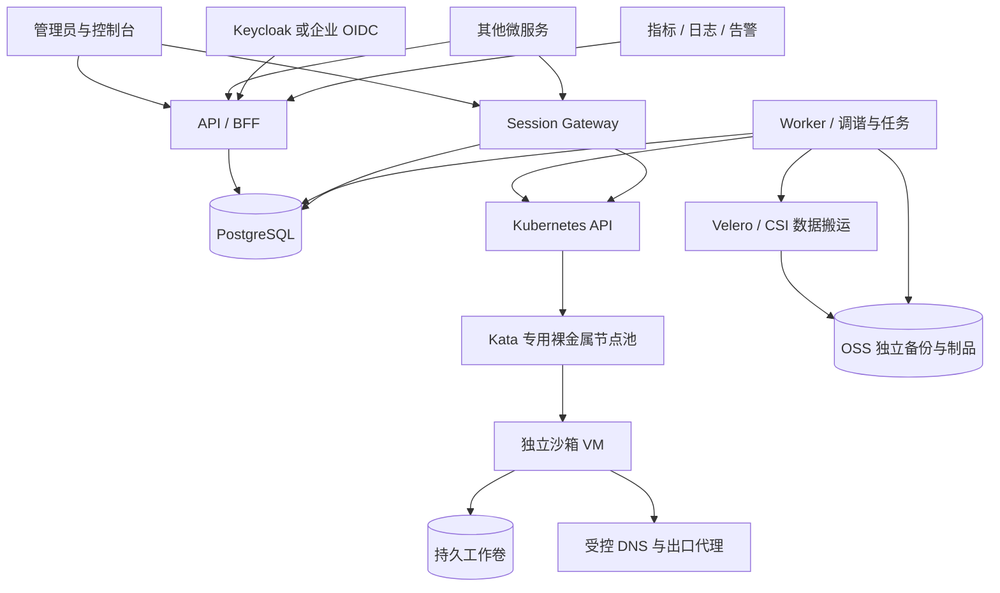

# Rust 沙箱平台生产开发方案

版本：1.0 设计基线｜调研日期：2026-10-03｜适用：企业多租户、执行非可信代码、公有云从零建设。

本文承接[可行性预研](rust-sandbox-feasibility.md)，给出可交给研发、测试和运维执行的生产交付方案。用户最新要求已纳入：**产品必须能独立运行并提供身份认证，也能对接统一身份，供其他微服务按需组合调用。** 阿里云是当前参考部署，不代表云供应商已最终采购确认。身份模式、运行时落地、执行边界和工期以本文的新决策为准，覆盖预研中的对应假设。

本文是开发设计与验收合同，不是已完成的软件或已通过的压测报告。文中的容量、SLO、工期是待验证目标；上线必须满足最后的 Go/No-Go 条件。“开发完直接上线”落实为开发范围包含安装、升级、灾备、安全测试与生产放量，不把这些另列成未来补课。

## 1 冻结的产品与技术决策

可行，建议按一个独立沙箱产品建设。Rust 负责产品控制面、执行编排、权限、审计和 API；复用成熟虚拟化、容器、身份与备份组件。OpenSandbox、CubeSandbox 用于借鉴开发者接口和使用体验，不直接当成已经包含 ECS 式运维治理的完整产品，也不同时 fork 两套底座。[OpenSandbox](https://github.com/alibaba/OpenSandbox)、[CubeSandbox](https://github.com/TencentCloud/CubeSandbox)

| 决策项 | 首个生产版本的固定选择 |
| --- | --- |
| 产品形态 | 独立部署、API 优先、薄管理控制台；独立身份与企业身份两种安装配置 |
| 身份 | 独立版随包部署 Keycloak；集成版直接验证企业 OAuth2/OIDC；产品统一管理租户和资源授权 |
| 自研部署角色 | 一个 Rust 应用包，`api`、`worker`、`gateway` 三种进程角色；另含模板内一次性 runner |
| 状态源 | PostgreSQL 保存期望状态、业务权限、操作和配额；Kubernetes 保存运行资源与实际观测 |
| 运行时 | 自管 Kubernetes + containerd + Kata；每实例一个 Pod/VM，一个用户容器 |
| 阿里云落地 | 普通 ECS 承载控制/平台节点，弹性裸金属承载 Kata；Kubespray 安装 Kubernetes，IaC 创建云资源 |
| 网络 | Cilium，一套经过验证的配置；受控 DNS、出口代理、默认拒绝和宿主保护 |
| 数据 | 单实例单持久工作卷；阿里云 CSI 云盘；临时根目录可重建 |
| 备份 | CSI 快照派生卷经隔离 Kata VM 的 Restic/rclone 原始块通路导出独立 OSS 数据副本（实施更新见 §13）；导出/完整性与完整恢复验证分别标记，恢复操作须校验新卷 |
| 外部接口 | REST/OpenAPI + SSE/WebSocket；OAuth 机器身份；不再并行开发一套 gRPC 接口 |
| 异步任务 | PostgreSQL 操作表、租约、事件 outbox；不用 Redis、Kafka、Temporal 或通用工作流 DSL |
| 生产范围 | Linux x86_64、一个地域、一套锁定版本组合；完整交付用户要求的八项能力 |

首版不承诺内存休眠、无损进程迁移、Windows、GPU、多卷应用一致性和自动跨地域接管。它们不是实现八项基本能力的前提；API 明确返回不支持，避免隐性承诺。首版同一实例只允许一个活动命令或一个交互终端；需要并行任务时创建多个实例。

2026-10-12范围更新：资源利用率/浪费治理和GPU已列入[新增7个生产工作包](rust-sandbox-development-workbreakdown.md#11-资源效率与gpu新增交付顺序)，优先CPU容量画像/idle公开配置、并行真实GPU底座，再设备账本/监控/安全优化与弹性。前段描述仍是当前CPU运行基线，不能作为永久排除GPU的计划；GPU规格只有在对应SKU/版本/设备隔离与回收验证后开放。原CPU预算和排期不自动覆盖新增GPU范围，见[实施方案](resource-efficiency-audit-and-plan-20261012.md)。

阿里云弹性裸金属官方列明支持嵌套虚拟化；Kubespray 支持裸机与高可用部署；Cilium 提供 Kata 集成说明。这构成可实施路径，但不等于供应商为整套版本组合背书，组合测试必须在 G1 完成。[裸金属说明](https://www.alibabacloud.com/help/en/ecs/user-guide/elastic-bare-metal-server-overview)、[Kubespray](https://github.com/kubernetes-sigs/kubespray)、[Cilium/Kata](https://docs.cilium.io/en/stable/network/kubernetes/kata/)

当前不选择“ACK + runV + 任意 CNI”：ACK 沙箱节点文档明确约束 Kubernetes 版本、裸金属、操作系统及 Terway DataPath V2，ACK 还限制另装第三方 CNI。未拿到符合安全要求的受支持组合前，不把冲突配置写成生产方案。自管集群增加的 etcd、升级和兼容维护已计入人员与工期。[ACK 沙箱节点约束](https://www.alibabacloud.com/help/en/ack/ack-managed-and-ack-dedicated/user-guide/node-pool-management-in-sandboxed-containers)、[ACK 网络 FAQ](https://www.alibabacloud.com/help/en/ack/ack-managed-and-ack-dedicated/user-guide/faq-about-container-networks)

## 2 独立产品与组合部署

两种模式运行同一份业务程序、同一套 API、同一套授权测试。改变身份来源不改变实例、备份、任务和事件模型。

| 能力 | `standalone` 独立模式 | `external_oidc` 集成模式 |
| --- | --- | --- |
| 用户认证 | 安装包包含 Keycloak、登录/账户页面、MFA、密码恢复与邮件配置 | 使用企业 IdP 的登录、MFA、用户生命周期 |
| 机器身份 | 管理员创建 Keycloak service client，产品登记项目授权 | 企业创建 OAuth client，产品登记相同形式的授权 |
| 租户与项目 | 产品创建/禁用租户、项目、成员和配额 | 相同；可通过 API 与上游组织系统同步，不直接读取其数据库 |
| 密码和凭据 | 由 Keycloak 保存和轮换，产品不存用户密码 | 由企业 IdP 管理，产品不假装能管理任意 IdP 的密码 |
| 业务权限 | 产品 PostgreSQL 中的 principal/grant，按项目和动作校验 | 相同；外部管理员身份不自动成为产品超级管理员 |
| 界面 | 提供完整控制台，可独立运营 | 可保留控制台，也可只部署 API/worker/gateway 供平台调用 |
| 数据依赖 | PostgreSQL、对象存储、Kubernetes、监控等部署清单完整提供 | 可配置使用满足同一契约的企业基础设施，但须通过兼容验收 |

“独立”表示不依赖客户已有身份或业务平台即可安装运营，不表示用 Rust 重写数据库、身份服务器和虚拟机。“组合”通过 HTTPS 契约、事件和配置实现：其他产品不共享本产品数据库，不直接读取 Keycloak 内部表，不获得 Kubernetes 凭据，不要求部署到同一个进程或同一仓库。

组合接入交付四项：OpenAPI 与 SDK；机器身份注册/项目授权流程；版本化领域事件和 webhook；`GET /v1/capabilities` 返回支持的规格、能力、限额和部署版本。安全隔离、审计、授权与幂等是核心，不能被 feature flag 关闭。隐藏控制台不影响 API，禁用自动化不影响手动操作；关闭备份前必须处理已有策略、保留期限和在途恢复，不能直接遗弃数据。

每个安装默认一个活动登录 issuer，正常运行只接受该 issuer 的 token；受审计迁移窗口可临时允许新旧 token issuer 白名单。确需同时支持本地账户与企业登录时，可使用 Keycloak 原生身份代理，让产品仍信任一个稳定 issuer；外部直连是另一种安装模式。禁止按请求传入 URL 动态信任新 issuer；不首期建设可装任意认证代码的插件市场。[Keycloak 身份代理与管理](https://www.keycloak.org/docs/latest/server_admin/)

## 3 生产部署拓扑与基础设施清单



以下是高可用拓扑下限，不是 1000 实例所需机器数量。计算池容量另按第 21 节实测配置。

| 资源 | 生产基线 | 责任与限制 |
| --- | --- | --- |
| 云账号/环境 | 生产和预生产资源、凭据、状态文件隔离；备份采用独立权限域 | IaC 与 break-glass 权限分离；不共用管理员 AK |
| VPC/子网 | 一个地域、三个故障域；管理、平台、工作负载及数据访问边界 | CIDR 与企业网段不冲突；Kubernetes/DB/etcd 不向公网开放 |
| Kubernetes 控制节点 | 3 台普通 ECS，跨故障域；etcd 三成员 | Kubespray 锁版本；备份 etcd、CA、加密配置并演练恢复 |
| 平台工作节点 | 至少 3 台普通 ECS，跨故障域 | 只调度 API/worker/gateway/身份/可信基础组件，租户不可进入 |
| Kata 节点 | 至少 3 台目标裸金属进行 HA 验收；生产数量按容量测算 | taint/label/准入绑定；无数据库、备份、fencing 广泛云权限 |
| API/worker/gateway | 各 3 副本起步，跨平台节点分布 | 独立 HPA/并发预算；worker 按队列和实际执行资源扩展，不只看 CPU |
| 身份服务 | 独立模式 Keycloak 至少 2 副本，跨节点 | 专用 database 与 DB role；管理入口限制；SMTP/MFA/恢复完整配置 |
| 数据库 | 托管 RDS PostgreSQL 高可用、多故障域能力按所选产品核验 | 产品库与身份库逻辑隔离；TLS、备份、PITR、故障切换验收 |
| 云盘 | 加密云盘、CSI、snapshot-controller | `WaitForFirstConsumer`；容量/挂载数/快照额度前置确认 |
| 对象存储 | OSS 中备份、执行输出、审计归档、临时上传分别隔离前缀或桶 | 不同 RAM 权限和留存；跨权限域备份；回收策略不可混用 |
| 镜像与密钥 | 私有镜像仓库、KMS、受控 Secret 分发 | digest/签名；镜像与密钥删除受实例和备份引用保护 |
| 网络入口 | 管理 API 默认私网 TLS LB；必要的用户入口独立配置 | 身份/管理域与非可信应用域分离；工作负载域不能拿到管理 Cookie |
| 观测 | 本部署固定使用阿里云托管 Prometheus 和 SLS，标准采集协议 | 产品封装授权查询；不允许租户任意 PromQL/SLS 查询 |
| 云侧操作 | 专用 fencing 身份和云资源标签约束 | 只能关闭平台登记的故障工作节点；每次调用有操作账本 |

可移植性通过标准 Kubernetes/OIDC/Prometheus/OTLP 契约和配置边界保留；首版只认证这一部署组合。OSS/SLS/阿里云 CSI 的适配是实际云依赖，不能宣传“改一个参数就任意多云上线”。未来新增云需独立支持矩阵与验收，不提前实现没有使用方的抽象工厂。

G0 输出 `versions.lock.yaml`，记录 Kubernetes、Kubespray、宿主 OS/kernel、containerd、Kata/VMM/guest kernel/rootfs、Cilium、CSI/sidecars、Restic/rclone、Keycloak、PostgreSQL 主版本、Rust toolchain 和所有镜像 digest。基线选择仍受维护的稳定发行版；以实际地域支持和组合测试锁定版本，不把本次检索到的 latest 当成认证结果。

Kubespray 与 Cilium 的安装方式只能选一个配置所有者，避免 Helm 和 Ansible 同时覆盖网络参数。CSI 使用自管集群安装路径；阿里云 CSI 仓库对 ACK 内手工安装的限制不可误套，也不可忽略。[阿里云 CSI 驱动](https://github.com/kubernetes-sigs/alibaba-cloud-csi-driver)

## 4 身份、租户与授权的开发合同

### 4.1 身份主体与机器调用

外部身份唯一键固定为 `(issuer, subject)`，通过 principal_identities 映射到稳定的内部 `principal_id`。email、用户名和显示名只作资料，不能自动合并账户或继承权限。用户主体与机器主体明确区分；服务账号还记录可信 claim 映射得到的 client_id。正常是一对一映射，只有经过显式迁移审核才允许一个 principal 绑定新旧身份。默认一个微服务一个 OAuth client，禁止所有微服务共享超级管理员 token。

机器使用 `client_credentials` 取得 sandbox API audience 的短时 access token；优先用 Keycloak/企业 IdP 已支持的 `private_key_jwt`、证书或工作负载身份认证客户端。若选用 client secret，必须通过密钥服务保管、轮换且不得进入配置仓库。资源 API 验证 issuer、允许算法、签名、audience、exp/nbf、subject 和映射后的客户端标识；不接受 ID token，不根据 token 中的任意 URL 下载密钥。JWKS 未知 kid 限频刷新，失败不得放行。[OAuth 2.0](https://www.rfc-editor.org/rfc/rfc6749.html)、[JWT Access Token Profile](https://www.rfc-editor.org/rfc/rfc9068.html)

请求中的 project_id 只是授权目标。API以当前principal的本地grant解析tenant/project，不能直接相信`X-Tenant-ID`。issuer接入配置明确必需scope；token含细分scope时与本地grant取交集，不允许token扩展本地权限。为多租户代调的服务必须配置明确的项目allowlist或使用经可信IAM签发的租户上下文。调用方传入user_id只能作为业务标签，不能自动构成用户委托或提升权限。

### 4.2 用户登录和账户管理

控制台使用 Authorization Code + PKCE，由同一 Rust API 承担 BFF。浏览器只保存随机不透明的 `__Host-` 会话 Cookie：HttpOnly、Secure、明确 SameSite、Path=/、不设 Domain；token 加密保存在服务端有过期时间的会话记录中。校验 state/nonce/redirect URI，变更接口验证 CSRF/Origin；不把 access/refresh token 放 localStorage。管理域禁止承载租户 HTML，工作负载代理使用单独域名和短时会话授权。

独立版交付 Keycloak 登录/账户页面、管理员创建账户、验证邮箱/设置密码 required actions、MFA、密码恢复和邮件失败处理。产品控制台管理租户、成员、角色与 client grants；凭据创建/轮换复用 Keycloak 管理界面与 API，不另写密码库。安装仅生成一次性 bootstrap 管理凭据，启用 MFA 和正式运维账户后禁用 bootstrap。Keycloak 使用生产模式、TLS、专用数据库、受限管理入口、健康检查与备份；不使用 dev-file。[Keycloak 生产配置](https://www.keycloak.org/server/configuration-production)、[数据库配置](https://www.keycloak.org/server/db)

集成版不要求外部 IdP 提供 Keycloak 管理 API。产品明确哪些账户操作交由企业身份管理员，用户删除/禁用至少通过本地 grant 禁用即可立即阻断产品权限。企业目录同步是一项显式 API 集成，不默默把任意 OIDC group claim 转成管理员。

### 4.3 权限与撤销

默认固定角色：租户 Owner、项目 Admin、Operator、Reader、Auditor；后台映射为固定 action 清单。Owner 也不能绕过平台运行时隔离。机器客户端按最小 actions 授权，不默认继承人的 Owner 角色。

| 权限组 | 开发要求 |
| --- | --- |
| 实例 | read/write；`instances:hard_stop` 单独控制强终止全部进程 |
| 执行 | executions:create/read/cancel；执行权限不自动包含查看其他用户输出 |
| 数据 | files:read/write、workspaces:delete；删除实例不包含删工作卷 |
| 会话 | sessions:create，附加实例、用途、端口、时长限制 |
| 备份 | backups:create/read/delete/restore 分离；恢复同时需要目标项目创建权限 |
| 安全和身份 | security:read/write、members:manage、clients:manage；不能给别人授予自己没有的权限 |
| 治理 | audit:read、observability:read、automation:write、diagnoses:create/read、alerts:manage；自动化仍需被调用动作的权限 |

每次请求检查 principal enabled、本地 grant 与 authz_version；长连接每 30 秒重检，同时校验 token/session 到期。**产品本地撤权**到拒绝新操作/关闭存量连接目标不超过 60 秒。依赖不可用时新授权失败，既有连接在重检期限内关闭。worker 每次启动新副作用和每次自动任务都重新鉴权。平台为安全停止、已受理删除的必要清理保留系统身份，不因原用户撤权遗留危险进程；所有续行标记 `system_cleanup`。

**IdP 撤权另计。** 离线验证 JWT 不会立即获知 IdP 内禁用用户/client。独立版的产品禁用流程先撤本地 grant 和会话，再联动 Keycloak 禁用/登出；直接在 Keycloak 或企业 IdP 禁用则按实际同步能力生效。外部 IdP 只有经过验收的 backchannel/事件或 introspection 联动才能承诺同样的60秒目标；否则最迟到 access token 有效期加允许时钟偏差失效，建议冻结 access token 最长5分钟、允许偏差30秒。BFF刷新失败即结束会话，长连接不得超过认证有效期。接入验收要公开具体撤权上限，不能把本地 grant 检查包装成外部即时撤权。[Keycloak OIDC 端点](https://www.keycloak.org/securing-apps/oidc-layers)

客户端轮换分为 IdP 凭据轮换和本地权限撤销：测试新旧 key 窗口、真实服务切换、旧 token 到期、本地立即禁用及长连接关闭。grant、schedule和审计绑定稳定 principal，不绑定密钥版本；若 IdP 不支持同client双凭据，用两个经审核绑定的client完成迁移。凭据泄露时同时撤本地授权，不能只撤密钥后等待旧JWT失效。IdP签名密钥轮换和客户端凭据轮换分别验收。迁移 issuer 必须有显式 `(旧issuer,sub)→(新issuer,sub)` 映射、冲突审核、会话注销、grant保留和回退窗口，绝不按同邮箱自动认领；结束后移除旧issuer白名单。

## 5 Rust 代码结构与组件边界

业务保持一个 package，避免菜单一项一个微服务。共享模块直接调用；仅在确有两种实现的身份配置、可测时钟/外部接口边界建立必要封装，不为一个运行时提前写多层 provider trait。

```text
sandbox/
  Cargo.toml / Cargo.lock / rust-toolchain.toml
  src/bin/sandboxd.rs             # --role api|worker|gateway
  src/bin/sandbox-runner.rs       # guest 内一次性命令/文件协议，无监听端口
  src/auth/                      # JWT、BFF、principal/grant、授权
  src/api/                       # DTO、路由、错误、分页、OpenAPI
  src/domain/                    # 状态转换、不变量、配额、能力
  src/db/                        # sqlx 查询与短事务
  src/runtime/                   # Kubernetes 对象、exec、UID/generation
  src/operations/                # 调谐、领取、重试、取消、恢复对账
  src/sessions/                  # SSE、PTY、文件、端口授权
  src/backups/                   # Velero 资源、manifest、恢复验收
  src/automation/                # schedule/task_run、事件动作、webhook
  src/observability/             # 固定指标/日志查询与诊断规则
  migrations/ / openapi/ / sdk/ / console/
  deploy/helm/ / infra/alicloud/ / infra/kubespray/
  tests/contract/ / tests/e2e/ / tests/fault/
  runbooks/ / release/ / docs/adr/
```

Rust 采用 Tokio、Axum/Tower、Serde、sqlx、kube-rs、rustls、tracing/OpenTelemetry 等成熟库，锁定版本并持续检查安全公告。状态机使用 enum 和集中转换函数；对外 DTO 不直接复用数据库行。所有网络调用有 timeout、并发上限和取消信号；队列/输出/请求体均有界；不跨 await 持有数据库事务或全局 mutex。

API 不持有 Kubernetes 写权限；worker 的 Kubernetes RBAC 限于工作命名空间与必需资源；gateway 只获 exec/read 等必要能力。项目 namespace 的创建与 role 绑定由受控平台流程执行。API、worker、gateway、备份、CSI、fencing 分开使用身份，租户 Pod 不带这些凭据。

控制台采用一套常规 TypeScript 前端，静态资源可由 API 同域提供，全部操作走公开产品 API；后台不得“为了方便”直接改库。Rust 重点用于服务端，不强求前端和成熟基础软件也重写成 Rust。

## 6 八项能力的完整交付范围

| 模块 | 页面/API 必须包含 | 权威数据与完成条件 |
| --- | --- | --- |
| 实例详情 | 名称/标签、模板 digest、规格、期望/观测状态、时间/generation、工作区、网络策略、活跃操作、维护影响、能力列表 | DB 配置 + runtime 观测；过期显示 UNKNOWN，不能一直绿色 |
| 监控 | CPU/内存/限流/OOM、卷/空间/inode、IO/网络、执行/启动时延、配额；时间范围、告警与静默 | 来源、单位、采样时间、支持状态；不支持或缺测不填 0 |
| 操作记录 | 谁、以哪个 client、对哪个项目做了什么、何时受理/完成、结果/错误、前后配置摘要、request/operation ID | 受理与业务同事务；结果追加；租户不可修改历史 |
| 事件 | 实例/节点/任务/安全/备份状态变化；级别、首末时间、次数、关联操作；SSE/webhook | 持久领域事件；Kubernetes Event 仅作输入，不作为长期存储 |
| 安全防护 | 网络/运行时/镜像策略、当前应用版本、拒绝原因、主体/配额、隔离与解除隔离 | 期望与已应用版本分开；解除隔离需重新检查证据 |
| 健康诊断 | 固定规则、证据和时间、严重度、影响、建议与可授权动作 | 健康/异常/未知/不支持；诊断与修复是两个操作 |
| 定时与自动化 | 启停、备份、诊断、批准的命令模板；时区/漏跑/互斥/预算；运行历史和失败通知 | PG 持久调度点和 task_run；运行前重鉴权；不自动重放未知命令 |
| 备份 | 手动/策略、数据时间点、一致性、导出状态、保留、验证、恢复与删除保护 | 独立副本、可信 manifest、验证新卷恢复；不以创建快照即宣称完成 |

此外，模板目录、租户/项目、用户和 API client 授权、资源配额、平台设置、通知订阅属于产品基本面，随八项能力一起交付。ECS 只作信息架构参考；不能把“关机”“快照”等词直接套用后掩盖容器/VM 数据语义差异。

## 7 对外 API 契约

统一 `/v1`、HTTPS、JSON、UTC RFC3339、不可解释 UUID。管理 body 默认上限 1 MiB；命令参数/脚本字段总量 64 KiB；列表默认 50、最大 200。所有上限可按项目调低，提高上限需容量验收。请求未知字段拒绝，响应新增字段保持兼容；破坏性变更升 `/v2`。

| API | 用途/结果 |
| --- | --- |
| `GET /v1/capabilities`、`GET /v1/templates` | 能力、规格、模板不可变版本和限制 |
| `POST /v1/tenants`、`/projects`；`/v1/projects/{id}/grants` | 独立运营与组合系统管理租户/项目/授权，受管理权限限制 |
| `GET/POST /v1/service-clients`；`PATCH/DELETE /v1/service-clients/{id}` | 登记机器身份与本地授权、禁用；不代理签发token，不保存外部client secret |
| `GET/POST /v1/projects/{id}/grants`；`PATCH/DELETE /v1/projects/{id}/grants/{grant_id}` | 查询、调整、撤销项目权限；租户/项目本身同样具备列表、详情、更新与停用接口 |
| `GET/POST /v1/instances`；`GET/PATCH/DELETE /v1/instances/{id}` | 创建/查询/修改/销毁计算；变更返回 202 + Operation |
| `POST /v1/instances/{id}/actions/start`、`.../stop`、`.../restart` | 生命周期动作；明确持久化和进程影响 |
| `GET /v1/operations/{id}`；`POST /v1/operations/{id}/cancel` | 查询编排阶段；取消请求不是回滚保证 |
| `POST /v1/instances/{id}/executions` | 提交一个命令，返回 execution_id 和 operation_id |
| `GET /v1/executions/{id}`；`POST /v1/executions/{id}/cancel` | 结果/终止确定性；强取消范围为整个实例 |
| `GET /v1/executions/{id}/output`、`/output/stream` | 分块补读和 SSE 输出 |
| `POST /v1/instances/{id}/sessions` | 创建短时 terminal/file/port 会话；绑定具体用途 |
| `POST /v1/instances/{id}/file-transfers`；`GET /v1/file-transfers/{id}` | 上传/下载的持久任务与校验，不在 URL 拼 shell |
| `GET /v1/instances/{id}/metrics`、`.../logs`、`.../events` | 固定查询参数；授权后拼接预定义后端查询 |
| `GET /v1/audit-events` | 授权范围内操作审计、分页与时间过滤 |
| `GET/PUT /v1/instances/{id}/security-policy` | 版本化策略变更；返回 Operation 与应用状态 |
| `POST /v1/instances/{id}/diagnoses`；`GET /v1/diagnoses/{id}` | 异步诊断与结构化结果 |
| `GET/POST /v1/schedules`；`PATCH/DELETE /v1/schedules/{id}`；`GET /v1/task-runs` | 调度定义、禁用、执行记录 |
| `GET/POST /v1/automation-rules`；`GET/PATCH/DELETE /v1/automation-rules/{id}` | 事件条件、批准动作、冷却/预算、启用/禁用；共用task_run历史与执行前授权 |
| `POST /v1/instances/{id}/backups`；`GET/DELETE /v1/backups/{id}` | 备份、验证信息、受保护删除 |
| `GET/POST /v1/backup-policies`；`PATCH/DELETE /v1/backup-policies/{id}` | 自动备份周期、保留、禁用；不改变既有备份的删除保护 |
| `POST /v1/backups/{id}/restores` | 恢复为新实例/新卷，原实例保留 |
| `DELETE /v1/workspaces/{id}` | 单独数据删除权限和明确确认；不可由普通实例删除隐含触发 |
| `GET/POST /v1/webhook-subscriptions`；`GET /v1/webhook-deliveries` | 通知配置、签名轮换、投递记录与重投 |
| `GET/POST /v1/alert-rules`；`PATCH/DELETE /v1/alert-rules/{id}`；`GET /v1/alerts` | 固定指标告警规则与告警列表；ack/silence通过明确动作接口并设到期时间 |

短事务的授权/订阅等管理写入返回200/201并写审计；会话授权返回201。需要外部编排的实例、执行、备份、传输和诊断返回202+Operation。所有变更均可在操作记录中查询，不能把短事务伪装成后台任务。模板与策略版本的发布/下线、webhook更新/删除/轮换/重投、告警确认/静默均须在最终OpenAPI逐项声明；路由清单是开发合同，OpenAPI兼容检查负责防漏项。

表格中的省略路径表示同前缀下多个明确路由，实际OpenAPI分别定义；不接收任意动作名称或Kubernetes YAML。所有产生副作用的操作强制`Idempotency-Key`；修改既有配置与生命周期动作还要求`If-Match`。ETag只跟随`spec_version`，不会因为指标/心跳刷新不断失效。

成功受理示例：

```http
POST /v1/instances
Authorization: Bearer <access_token>
Idempotency-Key: 7fc85a4c-39d8-4be6-9932-1ed734a5ee78
Content-Type: application/json

{
  "project_id": "<project_uuid>",
  "name": "report-worker",
  "template_version_id": "<approved_template_uuid>",
  "flavor": "cpu1-mem2",
  "workspace": {"size_gib": 20},
  "security_profile_id": "<approved_policy_uuid>",
  "client_reference": "report-job-801"
}
```

```json
{
  "resource": {"id": "<instance_uuid>", "desired_state": "RUNNING", "observed_state": "PENDING", "spec_version": 1},
  "operation": {"id": "<operation_uuid>", "kind": "INSTANCE_CREATE", "status": "QUEUED", "stage": "ACCEPTED"},
  "idempotency_expires_at": "2026-10-10T09:00:00Z"
}
```

响应为 HTTP 202，含 `Location`、`Retry-After`、`X-Request-ID`。创建成功必须等到 Operation SUCCEEDED 且实例 RUNNING；受理成功、Pod 已创建和镜像已拉取都不等同于可执行。详情同时返回 `observed_at/observed_generation/spec_version/conditions`。

### 7.1 幂等、重试和分页

幂等作用域为 tenant + principal + 稳定操作名 + target + key；创建以项目为 target。key 最长 128 字节。规范化已校验请求与影响语义的条件头计算摘要；首次解析的模板/策略版本固化保存。相同 key/body 重放原受理回执，相同 key 不同 body 返回 409；重放前仍校验当前权限，之后不重新执行旧 If-Match 校验。

保证窗口 7 天；未完成 Operation 的记录不得提前过期。过期 key 墓碑保留 90 天，仍识别的过期 key 返回 410 和允许公开的原 ID；超过窗口客户端不得自动换 key 重提。幂等记录、配额、资源、Operation、受理审计同事务，不先单独写一个可能永久卡住的进度键。

SDK GET 可退避重试；变更仅用原 key 重试连接失败、408/429/502/503/504；401 刷新 token 后最多再试一次；403/404/409/412/422 不自动重试。起始默认单次请求 5 秒、受理预算 20 秒、最多 4 次且不超过总预算，遵守 Retry-After。等待 Operation 的超时只返回 ID，不取消任务。DB commit 结果不明时仍用原 key 查询受理，绝不生成新执行。

列表用 `(created_at,id)` keyset cursor；游标签名绑定租户/项目、筛选、排序、截止时间和版本，默认 24 小时有效。允许响应新增字段，不承诺并发修改下的历史快照。未经授权资源与不存在资源统一 404；可见资源缺少动作权限返回 403。

### 7.2 错误契约

使用 `application/problem+json`，字段为 type/title/status/detail/instance，扩展稳定的 code/request_id/retryable/operation_id/violations。客户端按 code 分支，不解析错误文案。[RFC 9457](https://www.rfc-editor.org/rfc/rfc9457.html)

| HTTP | 稳定 code 示例 | 处理 |
| --- | --- | --- |
| 400/422 | INVALID_ARGUMENT / CAPABILITY_UNSUPPORTED | 修复参数或使用受支持能力 |
| 401/403/404 | UNAUTHENTICATED / PERMISSION_DENIED / RESOURCE_NOT_FOUND | 刷新认证或修复权限，不盲重试 |
| 409 | OPERATION_CONFLICT / IDEMPOTENCY_KEY_REUSED / QUOTA_EXCEEDED | 查阻塞操作、修正请求或申请配额 |
| 410/412 | CURSOR_EXPIRED / IDEMPOTENCY_WINDOW_EXPIRED / VERSION_MISMATCH | 对账或重新读取后由业务决策 |
| 429 | RATE_LIMITED | 按 Retry-After 在原请求预算内退避 |
| 503 | CAPACITY_UNAVAILABLE / DEPENDENCY_UNAVAILABLE | 原 key 确认受理；容量和租户配额分开解释 |
| 500 | INTERNAL | 关联 request_id，禁止向租户返回堆栈/SQL/凭据 |

GET Operation 成功读取一个失败任务仍返回 200，任务错误在 Operation.error 中。`retryable` 从不表示允许重新运行结果未知的业务命令。

## 8 数据库与事务设计

租户资源必须带 tenant_id/project_id，复合唯一键和外键阻断跨租户引用；不能只依赖每个开发者记得 WHERE tenant_id。关键筛选/状态/约束用独立列，受限 jsonb 仅保存快照和扩展错误。时间用 timestamptz；大输出和文件不存 PG。

| 表组 | 关键字段与约束 |
| --- | --- |
| tenants/projects/principals/principal_identities/grants | 外部`(issuer,subject)`唯一映射稳定principal；enabled/authz_version；项目不可跨租户移动；grant actions明确 |
| browser_sessions/service_clients | 会话到期、加密 token、principal/version；客户端映射和状态，不存用户密码 |
| sessions/file_transfers/alert_rules/alerts | 授权主体、实例generation、用途/到期；传输checksum/额度/状态；规则版本与确认/静默到期 |
| template_versions/security_policy_versions | 不可变 digest/版本；能力/参数边界；审核状态；引用保护 |
| instances | desired/observed、spec_version、runtime_generation、cluster_epoch/launch_id/pod_uid、observed_at、workspace_id、active_operation、activity_kind/activity_id/activity_generation/slot_held、deleted_at |
| workspaces | 云盘/CSI ID、zone、size、key_ref、attachment_generation、retention、状态；独立于 Pod 生命周期 |
| operations | kind/status/stage、不可变请求、actor、deadline、lease_owner/token/until、attempts、next_attempt、cancel_requested、error |
| executions | instance/generation/pod_uid、dispatch_attempted_at、status、timeout、termination_status、exit_code、output_manifest、client_reference |
| idempotency_keys | scope/key_hash 唯一、request_hash、原回执、resource/operation ID、expires/tombstone |
| quota_accounts/reservations | pending/allocated 各维度非负；operation/resource 预留唯一；释放与终态同事务 |
| audit_events/domain_events | 不可变事件、tenant/time 索引、request/operation/aggregate/version；事件就是 outbox |
| schedules/task_runs | 时区/规则/actor/next_run；`schedule_id + spec_version + scheduled_at` 唯一 |
| automation_rules | 事件类型/条件/动作版本、actor、cooldown/小时预算、enabled/spec_version；task_run以rule+version+event_id去重 |
| backups/backup_policies | 数据时间点、源版本、一致性、manifest、verify_status、保留、删除状态 |
| diagnoses/webhook_deliveries | 规则/证据版本；投递 event+subscription 唯一、退避/lease/状态 |
| external_resources | provider ID、kind、owner、generation、operation、observed/deletion 状态；含临时备份卷 |

API 事务顺序固定：解析授权租户 → 设置事务局部 tenant context → 检查 grant → 幂等查重/竞争 → 锁配额 → 校验并预留 → 写资源和 Operation → 写审计/领域事件/回执 → COMMIT → 202。READ COMMITTED + 明确锁与唯一约束为初始基线，事务中不调用 Kubernetes、IdP、云 API 或对象存储。

RLS 作为第二道防线：API DB role 非 owner、非 superuser、无 BYPASSRLS，租户表启用并 FORCE RLS；在每个事务用 `set_config('app.tenant_id', ..., true)` 设置，不在池连接会话级残留租户。跨租户领取任务用独立最小权限角色，执行租户操作再进入租户事务。SQL 仍显式绑定 tenant 条件，RLS 不代替动作授权。[PostgreSQL RLS](https://www.postgresql.org/docs/current/ddl-rowsecurity.html)

任务领取采用短事务 `FOR UPDATE SKIP LOCKED`，更新 owner、30 秒租约与单调 lease_token，提交后再进行外部调用；每 10 秒续期。完成写入必须匹配旧状态和 lease_token。SKIP LOCKED 只用于队列，不用于需要完整视图的普通查询。[PostgreSQL SELECT](https://www.postgresql.org/docs/current/sql-select.html)

关键约束示意，最终 DDL 由迁移文件生成并集成测试：

```sql
-- execution 槽必须覆盖派发未知；实际终止确认后才可释放。
CREATE UNIQUE INDEX execution_one_active_per_instance
ON executions (tenant_id, instance_id)
WHERE slot_held = true;

-- 防跨租户引用，相关资源均建立同型复合唯一键。
ALTER TABLE instances ADD CONSTRAINT workspace_same_tenant
FOREIGN KEY (tenant_id, workspace_id) REFERENCES workspaces (tenant_id, id);

-- 幂等调度点；新的计划版本不会覆写旧运行事实。
CREATE UNIQUE INDEX task_run_once
ON task_runs (schedule_id, schedule_version, scheduled_at);
```

统一活动槽固定在 instance 行：activity_kind/activity_id/activity_generation/slot_held。execute、PTY和文件写入均锁同一instance行，在同一事务校验空闲并占位；各子表索引只作额外约束，不承担跨表互斥。终端断线、helper超时、worker失租都不能直接释放槽，必须确认远端活动结束；无法确认时停止整个VM后再释放，避免重连产生第二个仍活着的shell。未知命令可永久保留OUTCOME_UNKNOWN，同时在确认VM终止后释放slot；不能改成CANCELLED来隐藏之前的未知业务副作用。

事件/审计按时间分区；实例列表、到期任务、资源历史、租户时间查询建立明确索引。不预分片、不任意为 jsonb 全字段加 GIN。配额统计使用预留和实际分配账本，包含失败清理未完成资源；后台定期核对云盘/Pod/对象账，不单靠 count(RUNNING)。

## 9 生命周期与调谐状态机

期望状态：RUNNING、STOPPED、DELETED。观测状态：PENDING、STARTING、RUNNING、STOPPING、STOPPED、DELETING、DELETED、ERROR、UNKNOWN、QUARANTINED。每次变化附条件、证据时间和 generation；Operation 失败不强行覆盖实际状态。

Operation 状态：QUEUED、RUNNING、WAITING、SUCCEEDED、FAILED、CANCELLED；WAITING 必须有 reason、next_check 和 deadline/escalation，不能永久无告警。实例 start/stop/restart/delete/恢复切换互斥，冲突返回 409 和有权限查看的 blocking_operation_id。安全停止可中断执行/备份，但必须进入固定协调流程。

| 操作 | 固定阶段 | 完成条件 |
| --- | --- | --- |
| 创建/启动 | 预留 → 建安全边界 → 建 PVC → 建 Pod 消费卷 → 观测就绪 → 发布路由 | 本 generation 的卷、RuntimeClass、强制策略与执行探测均就绪 |
| 停止 | 拒绝新写/会话 → 撤路由 → 停执行 → 终止 Pod/VM → 确认卸载 | 旧 VM 确认终止；PVC 保留；不保留内存和根目录临时修改 |
| 重启 | 完整停止 → generation++ → 挂原工作卷启动 | 旧写者已消除；新实例环境可用 |
| 销毁实例 | 持久墓碑 → 停止 → 清计算/路由 → 确认资源回收 | 默认工作卷和备份保留；保留资源仍占其对应存储配额 |
| 删除工作区 | 独立权限/确认 → 无活动写者 → 云侧删除 → 验证 | 盘已删除才释放该存储配额；不删除备份 |
| 恢复 | 校验备份/权限 → 新卷新实例 → 校验数据 → 隔离启动 → 授权放通 | 不覆盖原卷；网络和权限使用当前规则 |

首版一个workspace只绑定一个instance，且namespace归属不迁移：PVC固定名 `ws-<workspace_uuid>`，Pod固定名 `sbx-ws-<workspace_uuid>`；generation与每次新启动的随机launch_id记在DB和对象元数据，不能随重启改PVC名称。Pod创建时即带平台finalizer：DELETE先触发终止，finalizer保留对象与名称；核对本UID的可信终止证据或云fencing后才移除。未知终止不能强删对象或清finalizer；删除命名空间也受相同保护。

准入强制工作PVC只能由该固定Pod名挂载、finalizer不能缺失、调度器固定、禁止显式nodeName/额外工作Pod绕行；不使用Deployment自动替换实例。旧worker的create即使晚到，也只能得到AlreadyExists或占住同一名称而阻塞新代，不能与新代并存；发现旧generation时先确认终止再清理。固定entrypoint只运行平台等待进程，不自动执行工作区脚本；错误代不发布路由、不接受exec。新工作区/恢复新卷才有新PVC和Pod固定名。

create响应超时后GET同名对象核对owner/UID/spec hash；更新/删除绑定UID/resourceVersion，不能以同名替代身份校验。PVC不设置Pod ownerReference。watch用于及时观测，周期LIST对账用于断流修复；故障测试必须覆盖“旧create在新代启动后才到达”和“节点分区时删除对象”的组合。

`WaitForFirstConsumer` 下必须创建消费者才能触发卷选区绑定；流程不能先无限等待 PVC Bound 再创建 Pod。调度沿用 Kubernetes；业务只选允许节点池、约束可用区、配额和优先级，不实现第二套节点调度器。

lease_token 只阻止过期 worker 写数据库，不能撤销在途 Kubernetes/云 API。生命周期通过确定名称、UID、generation、墓碑收敛；无法证明外部结果时查询/等待，非幂等执行走下一节的“不重发”规则。删除墓碑、资源 owner 及 operation ID 进入独立归档，供灾备对账。

### 9.1 计算期限与自动回收

完整实现还包含计算TTL、续期、闲置停止和工作区保留回收。计算TTL从创建/启动受理开始计时，到期默认停止计算并保留工作区；restart不重置期限，已受理停止不能被续期撤销。续期与过期领取共锁实例并使用锁后的数据库当前时间；新命令/会话/文件写入须在受理与派发时检查期限。idle默认关闭，运行中或结果未知的活动不算闲置；卷与备份的保留独立，自动删卷必须有有效删除预授权和引用保护。

上述能力在G2完成后端、G3完成策略与界面、G4完成竞态和故障验收。字段、API、回收锁和测试要求见[分阶段开发表第8节](rust-sandbox-development-workbreakdown.md#8-生命周期专项开发表)。

## 10 命令、终端、输出与文件

### 10.1 单次派发的 execute

API接受命令后，worker经Kubernetes `pods/exec` 启动模板内一次性Rust runner。exec URL只包含固定runner路径、协议入口和目标容器名，argv/env/秘密输入从有界stdin JSON传入；避免脚本进入Kubernetes审计URL。正常采用argv数组，只有调用者显式选择`/bin/sh -lc`才解释shell。[kube-rs AttachedProcess](https://docs.rs/kube/latest/kube/api/struct.AttachedProcess.html)

固定Pod名要求额外防止exec命中新代：Kubernetes exec没有原子UID前置条件，GET后再exec仍有竞态。用户容器名固定为本次启动唯一的 `workload-<launch_id>`，每次重建生成并持久保存新随机ID；所有exec/attach/file请求必须指定该容器名，并核对epoch/generation/pod_uid，不能默认第一个容器。旧请求迟到只会找不到旧容器，不会落入新实例。灾备提升epoch且不复用launch_id；Pod `restartPolicy: Never`防止同名容器自动重新运行。

```json
{
  "argv": ["python3", "/workspace/jobs/report.py", "--job-id", "report-801"],
  "cwd": "/workspace/jobs",
  "env": {"TASK_MODE": "batch"},
  "timeout_seconds": 300,
  "on_timeout": "HARD_STOP_INSTANCE",
  "client_reference": "report-801"
}
```

默认300秒、首版最大3600秒；超时策略必须在提交时可见。`HARD_STOP_INSTANCE`需要对应权限，可能停止后台进程、终端和端口服务。首版one-active-slot限制平台接受的命令/交互终端/文件写入，不声称恶意代码不能自行fork或留下后台服务；需要任务间严格无残留，应在两任务间停止重建实例。文件只读可限流并行，但不保证与运行程序一致快照。

Execution 保存命令结果；Operation 保存派发/停止编排。执行状态为 QUEUED、DISPATCHING、RUNNING、SUCCEEDED、FAILED、TIMED_OUT、CANCELLED、OUTCOME_UNKNOWN，另有 `termination_status` 和 `output_status`。正常退出码是工作负载报告，不证明外部业务动作成功，也不能当安全审计事实。

派发规则必须按以下顺序实现：

1. DB 同事务保存 Execution、Operation、配额/占位、幂等及审计。
2. worker 在实际 exec 前持久化 DISPATCHING、pod_uid、generation、attempt ID、截止时间。
3. 只发一次 exec；关闭 HTTP/代理层对此请求的自动重发。
4. 派发后崩溃、断链或结果不明，接任者标记 OUTCOME_UNKNOWN 并保持占位，不重跑命令。只有可证明请求从未派发才可重新排队。
5. 有可信进程退出通道则保存结果；输出保存失败不改成命令失败再重试。没有结果时保留未知，允许追加迟到证据。

同 UID 恶意命令可以杀 runner、fork/setsid、篡改工作区回执。runner 的本地超时和 killpg 只作合作式机制；**强取消/强超时通过停止整个 Pod/VM 实现**。先撤销会话/入口并尝试终止，随后确认 VM 已死或完成云侧 fencing。请求已接受、发送 SIGKILL、Pod 对象已删除都不是终止证明。

`timeout_seconds` 是开始强制终止的执行截止时间，不承诺控制面/节点分区时在该秒物理终止。终止不明返回 TERMINATION_PENDING/UNKNOWN 并告警；不伪报成功。确认停止仍不能确定之前是否完成外部写入，OUTCOME_UNKNOWN 的业务结果不自动改成“未执行”。微服务应持久保存 execution_id 和自己的业务幂等键进行对账。

### 10.2 有界输出和会话

stdout/stderr 以 sequence/stream/offset 分块，原始字节 base64，持久块含 checksum；只保证平台接收顺序。每次默认输出上限 16 MiB，超出后继续排空并丢弃超额，标 TRUNCATED，不因不读管道把进程堵住。块持久化后才向可重连 SSE 发布；对象存储异常时有界缓冲后标 PARTIAL/LOST，按项目策略停止或继续计算，禁止无限内存增长。

SSE 15 秒心跳，支持 Last-Event-ID；补读 API 明确最早保留序号。过期返回 410；慢消费者缓冲上限 256 KiB 后断开并补读。用户断开 SSE 不取消命令。终端用 WebSocket，绑定实例 generation/pod_uid、用途、过期时间和授权版本；会话凭证不能升级为管理 API token。

端口代理只允许产品批准端口和固定实例映射，不接受任意目标 IP/URL；不为每实例创建一个公网负载均衡。节点/Pod 替换后旧会话失效。网关重启时 SSE 可补读，交互 PTY 可能断开，需要用户重连；不承诺透明恢复终端内存。

### 10.3 文件边界

首版单文件传输默认 100 MiB 上限、项目字节预算；大制品走受授权对象存储。上传临时前缀短期授权、长度上限、checksum、自动清理；校验后通过 helper stdin 写 `/workspace`。下载反向流式传输。使用目录 fd 和 `openat2`/等价安全解析，阻止绝对路径、`..`、symlink/magic-link 和 TOCTOU 逃逸；临时文件 fsync 后原子 rename。

不默认解压不可信 tar，不拼 shell 执行 kubectl cp；若将来支持批量归档，必须独立做路径/链接/解压额度测试。文件系统的安全打开保护平台操作路径，不保证恶意 workload 随后不改文件，也不将上传完成解释为应用已经读取。

## 11 不可信多租户安全底座

威胁主体包括恶意租户、被盗服务 token、被攻陷的 guest、恶意镜像/文件和发生分区的旧节点。信任边界为云管理层、受控宿主和产品控制面；Kata 降低逃逸风险但不是“永不逃逸”证明。发现可利用内核/VMM漏洞必须有停新建、节点隔离、镜像替换和客户通知流程。

Pod 模板由平台生成并准入校验：强制 Kata RuntimeClass、专用节点池、non-root、只读 rootfs、drop ALL、无 privileged/hostPID/hostIPC/hostNetwork/hostPath/设备透传、禁提权、不自动挂 ServiceAccount token、关闭 service links。tmp/run 有额度；固定 PID1/init；runner 位于不可写镜像；`restartPolicy: Never`，下一代实例由业务调谐器创建。RuntimeClass 缺失时失败，禁止回退 runc。

Pod 安全策略与网络隔离必须在执行非可信代码前生效，不能仅“等 Ready 后再加策略”。项目默认拒绝策略先创建；Cilium固定 `policyEnforcementMode=always`，不设置放行 `reserved:init` 的策略，并启用所选版本的 `enable-lockdown-endpoint-on-policy-overflow=true`。准入防止使用未准备命名空间，CNI不可用时新Pod不得绕过网络初始化。always模式也影响可信组件，平台、DNS、健康端点所需规则必须显式配置并验证。G1测试从第一个包、CNI重启、策略表溢出及更新窗口开始，证明无短暂放行。Ready gate只是状态显示，不是安全屏障。[Cilium策略模式](https://docs.cilium.io/en/stable/security/policy/intro/)、[初始化与lockdown](https://docs.cilium.io/en/stable/security/policy/lifecycle/)

网络只允许 gateway 到已授权端口、guest 到受控 DNS/出口代理。CNI/宿主防火墙封锁直连外网、云 metadata、节点管理端口、控制面、数据库、其他租户和绕过代理的路径。出口代理对最终解析/连接地址再次检查，防 DNS rebinding、重定向和 HTTP CONNECT 滥用；允许域名不等于允许它解析出的任意私网 IP。未验收 IPv6 时从云/节点/Pod 到代理全层关闭并测试。企业内网服务按确切地址/端口/身份登记，不开放整段私网。

仅设置 HTTP_PROXY 不构成强制出口。宿主流量与 link-local 也不能仅靠标准 NetworkPolicy 推断；使用 Cilium host firewall、节点访问策略和安全组验证实际路径。Cilium 官方明确 Kata 的 MTU/路由传播限制；基线保留 kube-proxy、使用单一 VXLAN 配置，实测保守 MTU；使用 socket LB 时设置 `socketLB.hostNamespaceOnly=true`。不因修 MTU 给租户容器 NET_ADMIN。[Cilium/Kata 限制](https://docs.cilium.io/en/stable/network/kubernetes/kata/)

镜像只能选平台批准版本，固定 digest、SBOM、签名、扫描和模板启动检查。自定义镜像走隔离构建流水线后再批准，不能在产品创建接口上传 Pod YAML 或宿主参数。CPU/内存/PID/临时盘/磁盘/inode/会话/输出/流量全有配额；requests/limits 包含测得的 RuntimeClass overhead，宿主 VMM 开销另监控。

secret 仅经专门 secret_ref 授权使用，默认无云凭据；不得把调用方 OAuth token 传给 guest。下发给恶意代码的秘密本身可被该代码读取和外传，因此必须任务范围、短时、最小权限，不能声称靠日志脱敏就保护了执行中的秘密。平台日志、审计、URL、trace labels 都不记录秘密值。

## 12 持久卷与节点故障恢复

工作区固定 `/workspace`；rootfs、tmp、进程内存、连接不持久。用户依赖要进入不可变模板或工作区环境。首版单卷，禁止用户直接改变 PV/StorageClass。云盘加密、`Retain` 回收保护，显式删除流程负责删除云盘及清理 PV；不能让 Retain 变成永久泄漏。

阿里云CSI现有文档列明RWO。RWO限制节点，不排除同节点多个Pod；RWOP还需驱动支持，所以设计不能假设未验证的RWOP。固定工作PVC/Pod名、平台finalizer、全部挂载入口准入、唯一launch容器和数据库活动槽共同限制正常路径，见第9、10节；故障路径仍必须消除旧节点写入能力。临时备份作业只挂快照派生卷，不绕过固定名称去挂运行中的源卷。[CSI驱动](https://github.com/kubernetes-sigs/alibaba-cloud-csi-driver)、[Kubernetes卷访问模式](https://kubernetes.io/docs/concepts/storage/persistent-volumes/#access-modes)

节点分区的固定恢复流程：

1. 实例 UNKNOWN，停止新执行、会话与迁移，隔离节点。
2. 以平台登记的云实例 ID 核对 owner 标签，调用最小权限云身份停止故障节点。
3. 轮询云端确认关机，或使用已经验收的存储撤权机制确认旧写者失效。
4. 确认 detach/attachment 状态后才允许新 generation 在新节点挂卷。
5. 旧节点恢复必须先隔离对账，再重新加入，不凭 Node Ready 自动复用旧 Pod。

Node NotReady、DB租约到期、强删 Pod、云 API 请求超时均不能证明旧写者停止。fencing不可达时保持阻塞并告警，不能为赶恢复时间双挂载。kube-controller-manager固定 `--disable-force-detach-on-timeout=true`，禁止其按不健康/超时自动强制卸盘绕过产品流程；只有云侧确认节点关机后，专用恢复身份才可添加 `node.kubernetes.io/out-of-service` 并执行受控恢复。节点生命周期、CSI、人工运维均不能提前force detach/delete；这一边界要用超过默认超时的网络分区测试证明。[控制器参数](https://kubernetes.io/docs/reference/command-line-tools-reference/kube-controller-manager/)、[节点关闭与恢复约束](https://v1-32.docs.kubernetes.io/docs/concepts/cluster-administration/node-shutdown/)

普通可用区云盘不是跨区副本。控制面三故障域不等于单实例可跨区无损接管；跨区恢复依赖独立备份、目标区容量和已经验证的恢复路径。单节点故障目标与可用区灾难 RTO 分别记录。

## 13 备份、恢复与保留

**实施决策更新（2026-10-03）：** 依据固定版本后端核验与真实本地恢复测试，数据搬运实现已改为受控 Kata VM 内的原始块流 → Restic 0.19.1/rclone 1.75.1 → 独立 OSS 仓库及封存副本。首版按可信停止后的冷备受理，恢复写入新卷；不在宿主挂载或解析租户文件系统。具体信任边界、签名清单与验证证据以 [备份实施说明](../docs/backup-infrastructure.md) 为准。下列 Velero/Kopia 描述保留为原评估记录，不再作为安装指令；独立副本与真实恢复验收要求仍有效。

主交付路径固定为**独立数据备份**：CSI snapshot → 派生临时卷 → Velero CSI Snapshot Data Movement/Kopia → 独立 OSS repository → 恢复新卷。OSS 中仅有 Kubernetes YAML/manifest 不能算工作区数据副本；本方案不以原生快照冒充独立导出。[Velero 数据搬运](https://velero.io/docs/v1.18/csi-snapshot-data-movement/)

G1 必须验证 CSI snapshot、Kopia repository、OSS认证/分片上传/校验、恢复 StorageClass、目标 topology 和所需文件语义。OSS 是 S3 部分兼容，Velero 的 Alibaba metadata provider 与 Kopia 数据通路不是同一兼容层；“插件存在”不能替代从 OSS 成功恢复。[OSS S3 兼容边界](https://help.aliyun.com/zh/oss/developer-reference/compatibility-with-amazon-s3)、[Velero provider 状态](https://velero.io/docs/v1.18/supported-providers/)

若该路径失败，G1 阻断并修正存储/备份组合后重验，不降级产品对数据副本的承诺，也不临时自写一个未验证的备份格式。快照/导出/恢复组件自身可能有高权限，部署在受控备份命名空间和允许节点，恢复时实际调度限制逐项验证；不能声称 Kopia 在任何拓扑都无需宿主访问。

默认在线备份仅为崩溃一致性。停机一致模式先停止并确认实例，再取快照；首版不提供任意应用的在线 freeze hook，避免给 guest 文件系统冻结特权及 worker 崩溃后永久冻结。以后新增应用适配必须验证数据库恢复语义，并具有独立 TTL/watchdog 解冻与持久补偿，不能只写 finally。

备份记录包括：backup_id、tenant/project、source instance/generation、template digest/runner版本、卷/文件系统元数据、数据时间点、一致性 requested/achieved、加密/key_ref、repository/manifest、完整性校验与恢复测试状态、retention_until。manifest 由平台生成并加签/校验，tenant 不能替换为任意对象路径。Kopia 仓库密码和 KMS 恢复材料单独保护与备份，避免备份数据存在却无法解密。

状态：QUEUED → SNAPSHOTTING → EXPORTING → VERIFYING → AVAILABLE，失败明确阶段。AVAILABLE 至少要求数据导出、manifest 与仓库完整性校验完成；另显示 `restore_tested_at`，不可把“未做恢复测试”显示为已验证恢复。产品上线前源盘/原快照删除后的恢复必测；持续运行后定期抽样完整恢复。

恢复一律创建新实例/新卷：先校验源 backup read/restore 权限和目标 project create 权限 → 校验对象/密钥/镜像依赖 → 数据还原 → 文件语义/校验 → 默认 deny 网络启动 → 标记可检查 → 单独授权放通或切换入口。历史 token、grant、调度计划、外发 webhook 和 Pod RBAC 不从备份自动恢复；配置按当前策略重建，旧网络规则不得放宽当前基线。

起始保留：每 12 小时备份，最近 7 天保留全部，之后每日一个保留 30 天；保留可由项目加长并计费。RPO≤24小时按最新**可恢复数据时点**计算，预警 16h、紧急 20h、24h违约；周期不是 RPO。备份耗时目标≤2h 为容量验收值，达不到需扩吞吐或修订服务承诺。

Kopia 可变仓库不能直接全桶 WORM，否则可能阻断锁/索引/GC。数据防删使用独立备份身份、受限删除、版本/副本策略并验收恢复；审计归档可使用单独 WORM 桶。若要不可变备份副本，应另行验证与仓库垃圾回收相容的复制/留存方案，不把对象锁随手套到所有前缀。备份删除先标记、检查引用与保留，再通过官方维护路径回收；不手动删 repository 内块文件。

## 14 监控、操作审计、事件与诊断

### 14.1 指标与日志

宿主/runtime/CSI/CNI 是平台可信观测；guest 应用指标是租户报告，明确标注来源。CPU/内存/IO 用 Kata 实际暴露的能力映射；缺少磁盘 IO 指标时使用可验证云盘统计或返回 UNSUPPORTED，不填写 0。空间/inode 若来自 guest helper 必须标明 `guest_reported`，不能单凭它实施安全处罚。

固定指标目录包含名称、单位、聚合、来源、新鲜度和支持状态。采样起点 15 秒，状态/指标陈旧阈值 60 秒，图表显示缺口；查询支持固定时间范围与 step，超过范围拒绝或降采样。按 tenant/project/instance 授权后构建固定查询，禁止直接透传 PromQL。label 不包含命令、路径、URL、用户自由文本或 secret；时序基数/查询扫描量受配额控制。[Prometheus 指标实践](https://prometheus.io/docs/practices/naming/)

自管集群使用受控Prometheus采集组件经标准remote_write写入云托管实例，产品走只读HTTP查询端点；不要求把自管Kata集群换成ACK。部署验收包含采集HA/去重、断网WAL预算、TLS及写入/查询凭据分离，不照抄文档中的全权限示例。日志使用适用于自管Kubernetes的Logtail采集路径；Kata内任意文件不会天然被宿主采集器看见，首版明确支持容器标准日志和平台执行输出，额外应用文件日志须走批准采集协议。[Remote Write接入](https://www.alibabacloud.com/help/en/prometheus/user-guide/write-open-source-prometheus-data-to-an-alibaba-cloud-prometheus-instance-through-a-remote-write-address)、[SLS Logtail](https://www.alibabacloud.com/help/en/sls/faq-about-logtail)

执行输出保存 OSS 分块；平台与容器日志经标准采集进入 SLS；审计是独立 PG 事实与归档，不以日志采集成功代替审计提交。日志字段默认脱敏，全文查询限制范围/长度/速率。监控告警支持待处理、已确认、恢复、静默到期和通知失败状态，不只显示一个红点。

建议初始留存：指标高分辨率 15 天、降采样 90 天（按后端套餐和预算验收）；执行输出 7 天；产品事件 30 天；审计在线 90 天、归档 365 天。以上是产品默认值，不声称为任何法规最低要求；成本、客户合同与地域要求另行确定。

### 14.2 操作记录与事件

受理审计与业务事务一致，失败的鉴权/校验请求也记录安全审计但不创建虚假的成功 Operation。审计字段包括 actor principal/client、可验证委托主体、tenant/project、动作/资源、授权版本、request/trace/operation ID、受理/完成时间、脱敏 diff、结果/错误。API DB role 不可 UPDATE/DELETE 历史审计；归档失败积压达到预算要限制新变更并告警，不能悄悄丢记录。

领域事件与状态转换同事务插入 outbox，包含稳定 event_id/type/schema_version/resource/version/occurred_at/observed_at。事件流与 webhook 至少一次、可能乱序；业务消费者按 event_id 去重并查询当前资源状态。原始 Kubernetes Events 去重聚合保存，保留 reason/source/首末时间/count，不能依赖原生事件留存。

### 14.3 健康诊断

固定规则首批覆盖：排队/配额、无可用节点、镜像拉取、卷挂载、旧写者、OOM、资源耗尽、DNS/出口、策略未应用、证书到期、监控陈旧、备份过期、任务堆积、身份服务不可达。每条规则给 rule_id/version、采样时间、证据引用、状态/severity、影响、建议与可执行动作 ID。

证据缺失返回 UNKNOWN，能力缺失返回 UNSUPPORTED；不使用一个无法解释的“健康 93 分”。诊断默认只读，修复是新授权 Operation；安全隔离可由固定平台规则执行，自动解除隔离和破坏数据操作不得由诊断自行决定。

## 15 定时任务、自动化和事件通知

使用 PostgreSQL schedules/task_runs 与既有 worker，不再维护 Kubernetes CronJob 镜像业务状态。支持固定动作：start/stop、backup、diagnose、执行批准且有版本的命令模板；不支持任意动态插件或通用 DAG。

schedule 字段必须包含 IANA timezone、cron/一次性时间、目标、模板版本、actor、enabled、next_run、misfire policy、concurrency policy、deadline、最大重试和预算。默认错过执行点跳过；允许明确 catch_up_once，禁止无限补跑。DST 跳过时刻默认跳过，重复时刻只执行一次，逻辑调度点需在测试中固定算法；统一保存对应 UTC 时刻与本地解释。计划修改提升 spec_version，不修改旧 task_run。

多个 worker 以锁和唯一调度点创建一次 task_run，然后提交正常 Operation；不在 scheduler 内另写一套权限/运行时逻辑。每次触发重验创建者/服务账号 grant；凭据禁用不再创建新执行。操作互斥默认 FORBID，冲突记录 SKIPPED_CONFLICT；不用隐式队列把凌晨停机动作延迟到白天执行。

事件自动化只支持预定义事件→批准动作，包含 cooldown、每小时上限、条件版本和 correlation/causation ID，阻止“失败事件触发操作、操作失败再次触发”的循环。命令结果未知不自动重试；可重复的查询/诊断/备份编排允许有界幂等重试。

Webhook 为可选通知，轮询始终可用。订阅项目与固定 event_types，目标先注册/验证 HTTPS。签名 HMAC-SHA256(timestamp + '.' + raw_body)，包含 key_id、timestamp、event_id；消费者做时间窗校验、常量时间比较和事件去重。重试使用新 timestamp、相同 event_id；5 秒总预算，仅 2xx 成功，429/5xx/超时退避加抖动，24 小时后失败告警，授权重投保留原 event_id。

禁止重定向，限制响应体与目标并发；DNS 与实际连接均防 SSRF。默认公网 HTTPS 回调；组合场景的企业内网回调使用管理员批准的具体网络 endpoint，不能开放任意私网 URL。Webhook 通知到达不是操作完成证据，也不是消费者业务动作恰好一次保证。

## 16 微服务接入的完整链路

交付至少一门真实调用方语言的 SDK 和 curl 参考。OpenAPI 生成基础类型/路由，少量手写 TokenProvider、幂等 key 管理、Operation.wait、SSE补读、错误类型和 webhook 验签。不为了展示同时维护六套手写客户端。

调用方标准顺序：

1. 为服务建立独立 OAuth client；产品授予目标项目最小 actions。
2. 取得正确 audience 的 access token，读取 capabilities/template，保存业务 job_id。
3. 用稳定 Idempotency-Key 创建实例，持久保存 operation_id/instance_id；网络重试复用原 key。
4. 等待创建完成，判断实际 RUNNING 和所需能力；等待超时后保留 ID 继续查。
5. 传输文件并验证 checksum；提交一次 execution，持久保存 execution_id 和业务幂等键。
6. SSE读取输出，断线按 sequence 补读；结果 UNKNOWN 进入业务对账/人工处理，不自动换 key 重跑。
7. 正常或明确失败后按策略备份、停止/销毁实例；工作卷是否删除独立决定。
8. 长期接入使用 webhook 降低轮询，但保留查询补偿和事件去重。

两类身份示例都要跑同一套接入测试：随产品部署 Keycloak 的机器身份，以及企业 IdP 的真实测试 client。兼容性验收检查 issuer/audience、client_credentials、签名轮换、撤权、时钟偏差和 key 不可用。只证明网页登录成功不算完成微服务身份集成。

## 17 安装、配置与生产交付包

最终 release 必须包含源码/二进制与 OCI digest、Cargo.lock/toolchain、SBOM/签名/构建来源、OpenAPI/SDK、SQL migrations、Helm/IaC/Kubespray 配置、版本矩阵、告警、验收作业、升级说明和运行手册。一个机器可读 release manifest 把它们绑定到同一 commit。

环境配置分为公共配置与 secret_ref，禁止默认生产密码、禁 TLS、任意 issuer、latest 镜像。必填参数包括地域/故障域、CIDR、节点 SKU/数量、域名证书、DB/对象存储、KMS、身份模式/issuer/audience、SMTP、监控/日志、配额、备份目的地、fencing权限和通知目标。chart schema 与启动校验拒绝不完整生产配置。

| 顺序 | 可重复安装动作 | 必须检查 |
| --- | --- | --- |
| 1 | IaC 创建网络、权限、加密、桶、DB、节点、LB | state 加密/锁定/备份；配置漂移；生产和预生产隔离 |
| 2 | 宿主镜像和 Kubernetes/etcd | KVM、内核、时钟、DNS、证书、etcd恢复、节点身份；禁超时force detach配置生效 |
| 3 | Cilium/containerd/Kata/CSI/snapshot-controller | 禁回退、网络首包隔离、MTU、挂盘/单写者、卷拓扑 |
| 4 | 身份/备份/观测基础组件 | 双身份配置、独立卷恢复、KMS、repository凭据 |
| 5 | 迁移任务 + API/worker/gateway + 控制台 | schema兼容、就绪、RBAC、TLS、quota、bootstrap关闭 |
| 6 | 合成测试和真实调用微服务 | 八项能力、授权负向、输出、恢复、告警和审计 |
| 7 | 生产小流量放量 | release digest相同；回退开关和值班就位 |

生产安装脚本必须幂等，可中断续行并验证真实状态；不把 curl main/master 的安装脚本当发布产物。预生产和生产使用同一 artifact 晋级，参数差异可审查。此文给出配置合同，正式可执行 Helm/IaC 与验收程序属于开发交付，不能把尚未验证的占位 YAML 宣称可直接上线。

## 18 CI/CD、升级、维护与回滚

PR 检查 fmt/clippy/编译、相关领域测试、真实 PG 事务与迁移、OpenAPI兼容 diff、依赖/secret/镜像扫描。权限、状态和存储变更必须加租户负向、并发、重试与崩溃点测试。每日在真实 KVM 预生产跑核心 E2E/备份抽样，不以本地 Docker 测试替代 Kata 验收。

候选版本通过新装、N−1→N、混合进程版本、应用回退、72h负载、安全与灾备矩阵。DB采用 expand → 兼容应用 → 回填验证 → 后续独立窗口 contract；迁移有锁/超时/续行方案，应用 rollback 不自动反向迁移数据。Keycloak schema、备份 repository格式、Kubernetes/CSI 都有独立升级恢复路径，不能一条 helm rollback 解决全部状态。

worker升级先停止领取、继续续租/完成有界工作，维护 drain 至最大允许执行窗口；强行中断进入 UNKNOWN，禁止接管重跑。gateway滚动允许 SSE重连，PTY/端口连接可能断开并明确通知。平台 PDB 和多副本不保证沙箱内进程无损。[Kubernetes Disruptions](https://kubernetes.io/docs/concepts/workloads/pods/disruptions/)

节点/内核/Kata采用新节点池 canary→一个故障域→扩大。旧节点停止接单，等待实例自然结束或执行合同允许的维护重启；持久卷保留，内存不迁移。维护策略需要项目可见：通知提前量、允许时间窗、最长延期、紧急安全补丁例外及影响。禁止无限等恶意长会话阻塞安全修补。

回退开关至少包含暂停新建、暂停新exec、暂停自动任务、撤销外发通知、隔离租户/节点、进入灾备安全模式。回退首先保护工作卷与现存负载，不批量删除实例来让看板变绿。

## 19 灾难恢复与值班手册

数据库 HA、数据 PITR、etcd恢复、Keycloak恢复和单实例恢复是不同程序，分别计时。etcd恢复后还需与产品期望状态和云资源对账；PG恢复后不能把旧期望状态直接重新执行。

特别是 PG 回到 5 分钟前可能丢失已删除实例、已撤销授权、已执行命令的记录。固定恢复流程：控制服务写入关闭 → 自动任务/新会话暂停 → 提升 cluster epoch 并轮换旧控制凭据 → 从云/K8s/独立审计/调用方账本对账 → 未知资源隔离 → 恢复当前主体授权 → 逐项批准可继续操作 → 恢复接单。找不到充分证据的执行保持 UNKNOWN；不能为达 RTO 重放命令或恢复旧管理员权限。

审计归档也是异步时，最后一段事实可能同时缺失；设计不得假定归档天然零 RPO。保守停机、调用方对账和人工裁决是明确灾备语义。standalone 的 Keycloak回滚也需禁旧会话/凭据、检查主体禁用和密钥状态，避免仅恢复产品库却重新允许已撤销账户。

| 手册 | 必须可由值班人员独立执行 |
| --- | --- |
| API/DB/队列故障 | 判断受理是否提交，限流/切只读，恢复后用原 key 对账 |
| 节点/存储故障 | 确认云资源身份、fence、禁止双写、重新挂卷、隔离旧节点 |
| UNKNOWN执行 | 查询已知证据、强停止、保留未知业务结果、联系调用方对账 |
| 备份超期/恢复失败 | 检查repository/KMS/空间/源版本，扩并发或修依赖，验证新恢复点 |
| 安全事件 | 暂停新建、收紧出口、撤会话、隔离节点/租户、保留审计和受限证据 |
| 身份/TLS/密钥 | 轮换、撤权测试、应急账户、证书到期与IdP故障处理 |
| 发布回退 | 停新副作用、回退兼容镜像、验证schema、保留操作账本 |
| 成本/容量 | 限额与资源账核对、停新建、扩容或清理已批准资源，不能擅删数据 |

每日检查备份和资源账，每周恢复抽样，每月覆盖模板/StorageClass轮转恢复，每季度演练 DB/etcd/身份灾备。核心告警具有 owner、严重性、阈值、手册、抑制/恢复条件；同时规划一级值班、二线运行时/存储和安全支持，不能认为研发人数自动等于 7×24 支持。

## 20 上线前测试矩阵

每份报告绑定 release digest、完整环境/版本、步骤、原始测量、request/operation ID 和结论；不是只有截图或一句“测试通过”。安全/数据完整性失败直接阻断发布。

| 编号 | 测试 | 必须证明 |
| --- | --- | --- |
| IAM-01 | standalone/external同套契约；错误issuer/audience/token；签名轮换 | 无fail-open；网页和机器身份分别验收 |
| IAM-02 | 两issuer同邮箱、账户/服务撤权、客户端轮换、BFF CSRF | 不串号、不越权；本地撤权≤60秒；IdP撤权符合冻结的同步或token有效期上限；token不泄露 |
| IAM-03 | Keycloak初始化、SMTP失败、升级、PITR和管理员恢复 | 无默认弱凭据；恢复后不复活已撤销权限 |
| SEC-01 | 跨租户/项目替换实例、文件、输出、cursor、备份、session ID | 全路径拒绝且不泄露存在性；合法路径仍可用 |
| SEC-02 | 首包、CNI重启、DNS/IPv6/代理绕行、metadata和宿主端口 | 隔离无短暂放行；允许目标可用 |
| SEC-03 | 非法Pod字段、错误runtime、镜像digest/签名、root能力 | 双层准入拒绝；Kata坏时不运行runc |
| SEC-04 | 路径/链接竞态、输出洪水、超大文件、恶意callback | 无逃逸/SSRF/OOM；有界背压且状态准确 |
| ST-01 | 10000次生命周期，各副作用前后kill worker | 无重复资源/旧generation复活；配额可对账 |
| ST-02 | 同key并发100次、body冲突、commit后丢响应 | 一份资源/操作/预留，原ID可恢复 |
| ST-03 | stop/delete/backup/execute竞态、旧lease回调、延迟旧Pod create/exec | 冲突确定；固定名/finalizer阻止双Pod；旧容器名不能命中新代；未知写者不释放 |
| EX-01 | DISPATCHING后断链、杀runner、fork/setsid | 不重放；强停止需整个VM确认；未知结果保留 |
| EX-02 | 大输出/二进制/UTF8分块、慢消费者、对象失败 | 完整性标志准确；无无限内存；补读契约成立 |
| VOL-01 | 断电、控制网络/存储网络单独分区、fencing失败、分区持续超过控制器默认强卸盘超时 | 无双写；控制器/CSI不绕过fencing；未确认旧写者前不重挂 |
| BK-01 | 实数据备份，删除原卷/快照后异集群恢复 | 独立数据可恢复；文件语义/校验和符合支持范围 |
| BK-02 | 缺块/损坏、KMS失败、凭据轮换、模板GC、保留/GC冲突 | 不伪成功；恢复依赖受保护；旧备份仍可恢复 |
| DR-01 | PG PITR到删除/撤权/执行之前；etcd历史恢复 | 不复活资源/权限，不重放副作用，未知隔离 |
| SCH-01 | 多副本、DST、漏跑、账号撤权、重复事件、时钟偏差 | 调度点唯一；无补跑风暴；动作重新鉴权 |
| OBS-01 | 采集断流、日志洪水、审计归档故障、标签膨胀 | 缺测可见；查询不越权；审计不丢；成本有界 |
| REL-01 | N/N−1混跑、schema迁移、应用回退、节点维护 | 数据/协议兼容；执行无自动重放；影响符合维护契约 |
| INF-01 | etcd/控制节点恢复、证书续期、CNI路由恢复、IaC重跑 | 自管底座可维护；无靠个人手工补丁的隐含步骤 |
| SDK-01 | 两个真实微服务，独立和企业身份模式 | 全链正确处理重试、超时、UNKNOWN和清理 |
| OPS-01 | 非原作者按runbook恢复、轮换、隔离和回退 | 操作可复现、耗时可计量、责任人可接管 |

## 21 容量、SLO 与成本

用户尚未给出真实并发、地区和数据变化率。以下是规划基线，不是已有性能：20租户、1000运行实例，每实例1vCPU/2GiB和20GiB工作卷，100并发execute，500常开低流量会话，管理100读QPS/20变更受理QPS。需用真实调用服务修订后冻结。

1000个持久工作区即约20000GiB逻辑容量，停止实例也占存储；备份容量依赖已用数据和变化率，不能按空盘压测推算。节点数按最大约束确定：CPU、内存+VM overhead、云盘每节点挂载数、Pod/IP、PID、网络、IO、备份临时卷，并保留节点故障冗余。初期不对内存超售，CPU策略公开。

```text
单节点承载上限 = min(CPU预算/实例CPU,
                    内存预算/(实例内存+测得VM开销),
                    可用云盘挂载数,
                    Pod/IP/PID/IO/网络等实测上限)
生产节点数 >= ceil(目标运行实例/单节点承载上限) + 所声明故障冗余
月成本 = 计算池 + 控制/平台节点 + 云盘 + 独立备份/临时卷
       + RDS/OSS/镜像/KMS + 指标/日志 + 带宽/LB/出口 + 值班维护
```

不在地域/SKU未确定时给出伪精确云账单。G0 以供应商当时报价和实测挂盘密度计算成本，纳入采购预算；裸金属的最小规格和挂盘约束可能比 CPU 更早成为成本瓶颈。

| 指标 | 初始目标与边界 |
| --- | --- |
| 管理 API | 月请求成功率99.9%目标；请求型错误预算为合格请求数×0.1%；时间型合成探测另行统计，不混算成分钟 |
| 请求时延 | 常规读P95≤300ms，变更受理P95≤500ms；不含异步任务完成 |
| 创建到可用 | 已有卷、节点/镜像可用的热启动P95≤10s为挑战目标；新卷冷创建单独公布实测 |
| 状态/监控新鲜度 | P95≤45秒；超过60秒显示陈旧/UNKNOWN |
| 撤权生效 | 产品本地撤权最迟60秒收敛；IdP直接撤权按已验收联动时限或token有效期+时钟偏差，分别公布 |
| 工作区备份 | RPO≤24h目标，12h调度留重试余量；按可恢复数据时点计算 |
| 单实例恢复 | 20GiB已用数据，从独立备份到校验可用≤30min目标 |
| 控制数据灾备 | RPO≤5min目标；安全对账在内的RTO≤30min目标，无法达到如实调整 |
| 单工作节点故障 | 有效fencing、存储可达、同区备用容量就绪条件下≤5min恢复目标 |

72小时正式压测前先阶梯升压。正式窗口24小时稳态/突发、24小时故障注入、24小时升级/恢复；保留全部原始曲线，故障窗口分别分析而不是删掉。常态创建1次/秒并对应回收，每小时100并发创建突发；execute平均10次提交/秒并含长任务；真实卷分别50%/90%使用，备份并发与运行IO混合。

Kubernetes exec 把 apiserver/kubelet 纳入执行数据面：必须测长连接数量、APF/请求预算、带宽、内存、断连清理和租户洪水。gateway CPU低不等于系统健康。达到声明规模才发布该限额；不足则扩容或降低公开容量后重新验收，不假称支持无限并发。72小时通过也不证明月SLA已经达成，正式可用性持续统计。

## 22 开发工作包、人员与里程碑

按从零公有云、自管Kubernetes、完整八项能力、独立/企业双身份和生产运维交付估算：**32–42周，8–10名核心成员，约60–90人月**。这是立项范围估算，G1完成后按实际兼容/性能差距重估；不能沿用只开发API或已有基础设施的工期。

核心配置：3名Rust后端，1名运行时/网络/存储，2名SRE/平台，1名QA，1名前端；安全审查与额外测试支持按阶段增加。需要明确产品决策人、值班负责人和云支持联系人。采购/配额/供应商缺陷时间另有风险缓冲，不靠堆应用开发人数消除。

| 工作包/窗口 | 开发任务 | 退出证据 |
| --- | --- | --- |
| G0 W1–W3：规格与契约 | 威胁边界、云资源/版本矩阵、双身份、OpenAPI、SLO/容量、ADR、IaC设计 | 明确region/SKU/配额/责任；接口与成本基线可评审 |
| G1 W2–W9：生产底座 | IaC、Kubespray/etcd、KVM/Kata/Cilium/CSI、Keycloak/外部IdP、备份/fencing、流水线 | 三故障域控制面；真实裸金属闭环；无网络绕行；删除源盘后独立恢复 |
| G2 W8–W17：产品内核 | PG模型/权限/RLS、幂等/配额、生命周期、单次exec、输出/会话/文件、审计事件、SDK | 10000次循环；并发和故障不重复执行/丢账；真实微服务端到端 |
| G3 W14–W25：完整产品 | 八项能力、控制台、告警/诊断、调度/自动化、备份策略/恢复、双模式安装 | 每项功能成功/错误/授权E2E；控制台全部使用公开API |
| G4 W24–W34：候选版本 | 72h负载、安全验证、PG/etcd/身份灾备、升级回滚、密钥轮换、手册演练 | 同一digest证据包；零未关闭P0/P1；隔离/单写者/恢复全部通过 |
| G5 W33–W42：生产接管 | 空环境生产安装、两个调用服务、逐级放量、值班接管、成本/SLO观测 | 正式release、可执行回退、生产记录、责任人签署上线 |

工作包可以并行，退出条件不能跳过。G1 若网络首包隔离、单写者、独立备份、OSS兼容任一失败，先修底座再扩展依赖功能；不以演示环境成功消除生产阻断。每个工作包拆成 issue 时附接口/表/不变量/测试/产物/owner，避免只有“开发监控”这类不可验收任务。

开发完成定义统一为：代码合并、契约同步、相关负向测试、观测/告警、权限与限额、升级迁移、恢复/清理、运行手册全部完成。不会把备份、审计、租户隔离留到“二期生产化”。

详细任务已拆为[分阶段开发表](rust-sandbox-development-workbreakdown.md)中的61个工作包（原54项加资源效率/GPU增量7项），逐项列出开发内容、交付物、验收与建议主责，并补齐TTL、续期、idle和保留回收。原CPU范围按42周基准排程展开；32–42周仍为早期估算，G1退出后依据真实结果和人员重新排程。新增GPU范围需要按支持矩阵、实机可得性和验收结果单独重估工期及预算。

## 23 上线 Go/No-Go 与放量

以下每项必须绑定责任人、验证日期、证据和候选digest；安全/数据完整性项无豁免通道。

- [ ] 基础设施/运行时完整版本矩阵冻结，真实SKU/地域/配额可用，IaC可从空环境重建。
- [ ] standalone和external_oidc均通过用户与机器身份、撤权、客户端轮换、灾备和安装验收。
- [ ] 八项能力与公开API全部完成，两个真实微服务可独立接入，无后台直接写库依赖。
- [ ] 非可信代码从首包起强制隔离，无runc回退、元数据/宿主/跨租户访问。
- [ ] 幂等、配额、旧worker、generation、删除墓碑、UNKNOWN执行均经过故障验证。
- [ ] 节点分区不能双写；fencing失败保持安全阻塞并告警。
- [ ] 删除原卷/快照后的独立数据恢复成功，镜像/KMS/repository依赖可恢复且受保护。
- [ ] PG/etcd/Keycloak回到历史状态不会自动复活资源、权限或业务副作用。
- [ ] 声明容量下72h混合负载达标，含apiserver执行通道；无未解释泄漏和超预算队列。
- [ ] 无未关闭P0/P1及可利用严重漏洞；更新后的攻击面已回归。
- [ ] 新装/升级/应用回退/节点维护、TLS/密钥轮换及备份格式恢复均已演练。
- [ ] SLO明确适用负载与故障范围，成本预算、值班、告警和应急手册已接管。
- [ ] 最终镜像、迁移、配置、OpenAPI、SDK、报告来自同一release manifest并签名。

放量顺序：内部种子租户 → 声明容量5% → 25% → 50% → 100%，每级至少覆盖完整业务峰值和一个备份周期。安全事件、数据不一致、快速消耗错误预算、无法收敛UNKNOWN、RPO危险均停止晋级。回退暂停新副作用并回退兼容控制组件，保留工作卷和操作账本。

最终交付应是“在锁定部署组合下可安装、可调用、可维护、可恢复的独立产品”。生产可用性由以上证据确认，不由文档里出现 Kubernetes、Kata、Rust 或高可用字样确认。
