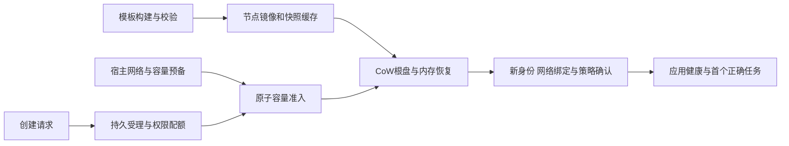

# 沙箱快启动、资源密度与 GPU：REA 方法逆向结论及生产落地方案

日期：2026-10-13。对象为企业多租户、执行非可信代码、长期保留工作区的 KnotSandbox。本文汇总公开源码、官方实验和本仓库启动链的调查；新增的是研究和开发计划，运行时、资源策略与 GPU 能力没有因此开通。

## 1. 结论与证据范围

CubeSandbox 和 OpenSandbox 的快速 CPU 沙箱主要通过提前完成模板构建、系统启动、网络准备和节点缓存，在线以磁盘写时复制、内存快照恢复、局部容量调度得到独立实例。磁盘共享基线与预热池分别减少复制和在线等待；Cube的MAP_PRIVATE内存共享有源码证据，Fast Sandbox的实际共享比例仍需PSS/脏页测量。它们没有消除实际工作集、并发写入、宿主缓存、平台组件与预热闲置成本。持续 CPU/GPU 高效率仍需真实任务的成功率、吞吐、尾延迟及成本证明。

本次按 [REA 固定工作流](https://github.com/morluto/rea/blob/172407787f1842dedbcd27b5385177595f786ce4/.agents/skills/reverse-engineer-anything/SKILL.md)执行问题清单、入口到状态变更的追踪、固定输入、观察/推断/未知分层与证据复核。该工作流对完整源码仓库明确采用普通仓库工具。此次完成源码级逆向、Git blob/文件 SHA 校验和公开原始样本的统计复算；没有启动 REA 原生反编译 provider，也没有取得我们自己的 KVM/GPU/实云性能数据。

| 输入 | 固定提交 | 证据覆盖 |
| --- | --- | --- |
| REA | `172407787f1842dedbcd27b5385177595f786ce4` | 研究工作流与包清单，只读 |
| CubeSandbox | `897def3abf1ad9b5df3d42fd4893d38c41ccabd9` | 3802个文本文件，逐文件Git blob校验 |
| OpenSandbox | `c806a49c62ee1fc3baa036165e9044e7b0efd97f` | 2817个文本文件，逐文件Git blob校验 |
| Fast Sandbox | `b702fbe71593df4f36b591e540445c251a698e7c` | 由OpenSandbox构建清单实际指向的底层运行时，551个文本文件 |

下载的媒体、二进制、symlink与超出读取预算的文件没有纳入文本负向检索。结论适用于上述固定版本与明确检查链路，不覆盖商业部署私有改动，也不把过往测试的镜像自动对应到最新源码。详细证据分别见 [CubeSandbox](cubesandbox-reverse-engineering-20261013.md)、[OpenSandbox](opensandbox-reverse-engineering-20261013.md)、[GPU专项](sandbox-gpu-reverse-engineering-20261013.md)。

## 2. 两个系统在线请求具体省了什么

| 机制 | CubeSandbox | OpenSandbox / Fast Sandbox | 对我们意味着什么 |
| --- | --- | --- | --- |
| 系统与应用初始化 | 先构建已运行模板；新VM恢复模板内核/agent状态并重设time/entropy，再probe应用 | 模板先准备kernel/execd；File memory backend快照恢复并等待guest /ping | 需要正式模板生产、签名、兼容与撤销链，不能仅缓存一个API对象 |
| 根盘复制 | XFS reflink/FICLONE，后续写块私有 | XFS CoW根盘，运行时初始化实际验证reflink | 基础盘可共享，用户工作区与备份仍保持独立所有权及旧写者fencing |
| 内存恢复 | 支持条件下同snapshot文件MAP_PRIVATE、默认不prefault；共享只读页，写页私有 | Firecracker LoadSnapshot/File backend；内存共享比例还需PSS/脏页实测 | API返回很快可能把I/O搬到首次访问；必须测first correct command及高写入峰值 |
| 网络/宿主准备 | TAP默认500、cgroup池3000，先建好再分配，缺货另处理 | warm Fastlet Pods与clean网络槽，一Pod承载多实例 | 节点缓存和clean槽必须有预算、owner、清理证明；池命中与池耗尽分别公布 |
| 分配与调度 | 本地模板性、容量过滤、buffer与分阶段并行 | Registry选择TopK，Fastlet原子准入；仍写K8s Sandbox CR | 减少每实例Pod调度可借鉴，但必须保留持久受理、实际容量及未知结果恢复 |
| 数据交付 | S3块按需读、本地缓存；默认每lvstore约1GiB RAM缓存 | 本地已校验artifact命中，冷下载是异步前置阶段 | 总节点成本包括缓存、预热和保留数据，不能只算VMM进程RSS |

机理源码：[Cube内存快/慢恢复](https://github.com/TencentCloud/CubeSandbox/blob/897def3abf1ad9b5df3d42fd4893d38c41ccabd9/hypervisor/vmm/src/memory_manager.rs#L1326)、[Cube mmap](https://github.com/TencentCloud/CubeSandbox/blob/897def3abf1ad9b5df3d42fd4893d38c41ccabd9/hypervisor/vmm/src/memory_manager.rs#L1506)、[FICLONE](https://github.com/TencentCloud/CubeSandbox/blob/897def3abf1ad9b5df3d42fd4893d38c41ccabd9/cubecow/src/engine/reflink.rs#L1079)、[Fast Sandbox CoW启动](https://github.com/opensandbox-group/fast-sandbox/blob/b702fbe71593df4f36b591e540445c251a698e7c/internal/runtime/firecracker/launcher.go#L221)、[LoadSnapshot](https://github.com/opensandbox-group/fast-sandbox/blob/b702fbe71593df4f36b591e540445c251a698e7c/internal/runtime/firecracker/restore.go#L299)。

这幅图解释的是可借鉴的架构路径。普通Docker、普通Kubernetes Pool、CPU模板恢复、用户运行态resume和GPU-ready是不同产品路径，分别计时和认证。

## 3. 公开性能数字的核对结果

| 公开实验 | 实际口径与结果 | 不能据此承诺 |
| --- | --- | --- |
| Cube模板创建 | 细化报告为本地模板、预热后单并发平均47.8ms；50并发P95 508.4ms。README另写50并发P95 90ms | 两份报告版本/完整口径未对齐，不用其中一个数替换另一个；没有我们的独立复现 |
| Cube实例密度 | 1000个空闲/create-only、2GiB名义内存实例，宿主增量摊销约25.7MB/VM；2GiB满写约185个只是估算 | 1000个不等于1000个满负载；进程小RSS不等于节点总成本；不证明CPU忙度高 |
| OpenSandbox热模板 | 官方ACK数据：串行100/100成功，P50约64ms；并发10为100/100成功，P99约125.4ms | 两节点大内存、已缓存模板、集群内客户端、10ms健康轮询、metrics关闭，不能当冷启动或GPU-ready |
| OpenSandbox并发20 | 51/100成功，48个429与1次就绪超时；成功样本P99约197ms | 排除失败的尾延迟不能代表可靠吞吐；实验含批次间回收等待 |
| OpenSandbox运行态恢复 | 三个同节点样本，SDK恢复到guest ready约62.66秒；局部runtime restore约35.49ms | 内部恢复耗时不能替代用户可用恢复SLO；create与resume不能混用 |

Open原始记录使用release-1.1.1-rc.1派生镜像，并明确startup_storage_guard_deployed=false；没有云SKU或裸金属属性字段，不能从部署指南的推荐条件补成该实验的硬件事实。

证据：[Cube公开细化报告](https://github.com/TencentCloud/CubeSandbox/blob/897def3abf1ad9b5df3d42fd4893d38c41ccabd9/docs/blog/posts/2026-06-01-cubesandbox-perf-benchmark.md)、[OpenSandbox原始实验记录](https://github.com/opensandbox-group/OpenSandbox/blob/c806a49c62ee1fc3baa036165e9044e7b0efd97f/docs/public/benchmarks/fast-sandbox-ack-2026-10-08.json)。我们仅对后者四组成功样本用nearest-rank重算百分位并核尝试数/成功率，结果与公开文件一致。这证明内部算术一致性，不能验证真实硬件、计时器或工作负载确实按报告执行。

“资源利用率”应至少分为逻辑槽位分配率、实际CPU/内存工作集、物理GPU活动、有效任务吞吐及单位成功任务总成本。库存集中、CoW共享与超分能增加分配密度；是否节省费用还取决于预热空闲、队列、OOM、重试、补容、节点下线和实际账单。没有这一闭环的实测数据，不能宣称任意负载都高效。

## 4. GPU结论与架构选择

| 路径 | 固定源码事实 | 本产品的边界 |
| --- | --- | --- |
| CubeSandbox GPU | README仍列路线图；GPUInfo/CDI/VFIO原语不等于产品授卡/计量/清理链 | 不能拿CPU内存共享密度作GPU结果 |
| OpenSandbox Docker/K8s | 已有整数GPU请求→Docker DeviceRequest或nvidia.com/gpu；K8s部分非法值被drop后继续，Docker相同情况400 | 统一强类型/显式拒绝；分配资格与物理独占、显存预算、算力份额分开 |
| OpenSandbox Fast Sandbox | 模板仅接受cpu/memory/disk，gpu明确400；固定runtime资源只有CPU/memory/PIDs | 64ms CPU路径不代表GPU初始化、CUDA上下文或模型加载已完成 |
| GPU遥测与安全复用 | 两仓所检链路未发现完整GPU busy/显存/SM→租户设备代际归属→安全释放闭环 | G1-11/G2-13/G3-12必须完整接设备许可、lease、归属、隔离清理、健康和账本 |

固定证据：[Cube路线图](https://github.com/TencentCloud/CubeSandbox/blob/897def3abf1ad9b5df3d42fd4893d38c41ccabd9/README.md#L410)、[OpenGPU转换](https://github.com/opensandbox-group/OpenSandbox/blob/c806a49c62ee1fc3baa036165e9044e7b0efd97f/server/opensandbox_server/services/docker/container_ops.py#L329)、[K8s解析行为](https://github.com/opensandbox-group/OpenSandbox/blob/c806a49c62ee1fc3baa036165e9044e7b0efd97f/server/opensandbox_server/services/k8s/provider_common.py#L55)、[模板拒绝GPU](https://github.com/opensandbox-group/OpenSandbox/blob/c806a49c62ee1fc3baa036165e9044e7b0efd97f/server/opensandbox_server/services/templates/template_service.py#L192)。

非可信通用CUDA的首期候选继续采用已认证的完整设备组独占，优先单卡节点匹配单卡任务。NVIDIA当前Kata参考组合要求全节点GPU给同一VM并采用cold-plug；GPU给CPU沙箱的外层容器，不代表guest CUDA能访问。MIG需独立模式/profile/设备代际、硬件与VM支持矩阵认证；time-slicing是共享访问名额，不能作为非可信跨租户显存/故障隔离。新版MPS已有独立地址空间和资源限制能力，仍不能直接视为VM硬件隔离或已被当前plugin栈支持。[NVIDIA Kata支持边界](https://docs.nvidia.com/datacenter/cloud-native/gpu-operator/latest/deploy-kata-containers.html)、[Kata cold-plug参考流程](https://github.com/kata-containers/kata-containers/blob/main/docs/use-cases/NVIDIA-GPU-passthrough-and-Kata-QEMU.md)、[NVIDIA共享模式](https://docs.nvidia.com/datacenter/cloud-native/gpu-operator/latest/gpu-sharing.html)、[MPS当前约束](https://docs.nvidia.com/deploy/mps/latest/when-to-use-mps.html)。

另一条可并行验证的高效率路线是CPU沙箱调用可信GPU服务：批准模型/固定backend、独立租户授权与有界队列、常驻模型及动态批处理，返回job级别时长/用量。它满足模型调用需求，但不提供任意CUDA代码直通；能力/API/计费必须单列。[Triton动态批处理](https://docs.nvidia.com/deeplearning/triton-inference-server/user-guide/docs/user_guide/batcher.html)。

GPU启动计时止于首次正确CUDA或模型结果；设备lease仅在输入/镜像/存储就绪及完整组准入后发放。低GPU-Util、进程列表空、Pod删除或CPU暂停都不能成为安全复用证明。清理失败进入QUARANTINED，设备归属和配额保持，按认证fencing路径处理。

## 5. 本仓库直接发现的启动等待

现有实现是持久Operation、独立workspace/PVC、Kata/QEMU冷VM与严格ready/终止账本。以下是本轮本地源码事实，尚未测得其生产时间分布：

- [worker.rs:174](../src/worker.rs#L174) 每个领取分支先sleep 500ms，并只claim一个操作；select其他分支还会重建计时future。它是控制面的领取机制，不是VMM启动时间，不能直接承诺平均250ms或生产QPS。
- [worker.rs:396](../src/worker.rs#L396) 首次记录网络策略UID后wait 1s；[PVC](../src/worker.rs#L411)、[Pod](../src/worker.rs#L429)也各wait 1s。未ready时[再wait 5s](../src/worker.rs#L436)。这些独立时间均在新资源路径中存在，短VM恢复仍会受其影响。
- [engine.wait](../src/engine.rs#L132) 持久next_attempt_at并限制retry为1..300秒，含租约检查与因果事件。优化应增加明确的即时继续/唤醒协议，不能把通用retry最小值偷偷改成0或跳过同事务日志。
- [host_profile.py:54](../deploy/nodeguard/host_profile.py#L54)明确要求Kata enable_template=false、vm_cache_number=0，并只允许kata-qemu。当前认证基线禁止VM复用；模板快路径需新profile/运行时adapter与完整认证，不改一个开关即开放。

因此优先改进顺序为分段观测→可靠队列唤醒与有界继续→镜像/节点准备→新认证模板快路径。PVC真实制备、调度、身份/策略ready和首次业务命令仍计入端到端结果，长保留工作区不因快启策略丢失或复用给其他租户。

## 6. 到生产落地的开发拆分

以下均为待开发或待实机认证的增量，沿用原61个工作包，不把研究完成记为功能完成。顺序已追加到[开发表第12节](rust-sandbox-development-workbreakdown.md#12-2026-10-13-竞品逆向输入与快启开发顺序)。

| 顺序 / 原工作包 | 技术与持久合同 | 具体开发及退出条件 |
| --- | --- | --- |
| P0-1 G0-07/G0-08/G3-03/G3-12 | 端到端分段、资源/成本有效期 | API accepted、durable commit、queue、placement/PVC、artifact、VM、policy/credential、route、first correct exec分别采样；raw成功/失败/取消/UNKNOWN、cache与pool hit/miss保留，基数/鉴权/缺测合同延续 |
| P0-2 G2-04/G2-05 | PG权威队列+事务内通知/持久事件+有界继续 | NOTIFY只作hint，监听重连/丢失/重复后仍SQL claim和扫描；空闲并发槽有界drain；已提交安全阶段可立即继续，实际未知/未ready仍回退wait。原lease token、workspace锁、当前授权、代际及外部副作用围栏全部保留；测重启/丢唤醒/饥饿/多replica/ACK丢失 |
| P0-3 G1-04/G1-09/G1-12 | 只读artifact与节点准备 | 签名digest与当前安全review有效；预拉批准镜像/kernel/driver，不预置租户凭据；cache/FD/network对象与补容有memory/disk/min-max预算；陈旧模板立即阻断，GC不删活动引用 |
| P1-1 G1-04/G0-06/G2-10 | 独立模板profile与工厂账本 | build→boot/probe→quiesce→snapshot→兼容/secret检查→签名发布→node cache→撤销/GC；profile绑定host/guest/VMM/CPU/microcode、网络及存储格式，暂不承诺通用GPU上下文恢复 |
| P1-2 G1-04/G1-05/G1-06/G2-05 | 快runtime adapter、黄金基线CoW与新launch | 只读基础rootfs/允许共享页，写页独立；fresh身份/密钥/entropy/time/网络；nodeguard许可和当前ready证据正常进入，持久workspace仍独立。未知恢复清理前不换节点重试；host每VM cgroup实际限额与祖先预算核验 |
| P1-3 G2-07/G3-13/G1-12 | 有权策略的idle与暖池/节点弹性 | 区分流量idle、后台/GPU任务、活动槽及保护；warm reservation单独入账/限定trust domain和owner；实机尾延迟与成本支持后才开CPU超分/暂停；内存不默认超分，不放开受保护固定节点 |
| GPU-1 G1-11/G2-13/G3-12 | 设备组profile、权威lease与归属 | 完整物理库存/assignment epoch/双范围配额/原子组；guest CUDA与driver/设备拓扑认证、可信清理/fencing/隔离。GPU状态checkpoint未认证明确拒绝；非法/unsupported无静默CPU降级 |
| GPU-2 G3-13/G4-09；MIG另需G1-11/G2-13/G3-12对应模式 | 可信GPU服务与另认证MIG模式 | 服务接OIDC/tenant/project、approved model、fair bounded queues、deadline/cancel、模型批处理；通用CUDA与受限推理API不同capability。MIG geometry与设备profile不混算，runtime/profile/设备lease/计量须独立实现认证，不能复用独占组的验收结果；可信受限GPU服务可并行验证 |
| 发布门 G4-01/G4-02/G4-05/G4-09 | 同条件完整负载与安全成本验证 | 真KVM/真GPU/目标云SKU，至少72h持续到达而非只测batch；同SLO成功率/吞吐、冷暖/高写/节点故障/全池耗尽/归属撤权、设备残留/租约故障及真实账单，安全或正确性失败不得被省资源覆盖 |

## 7. 可复现测量与上线规则

公开可复现基准必须绑定源码、部署/镜像digest、host/guest/VMM/driver版本、节点CPU/内存/GPU数量、资源profile、存储与网络拓扑、warm库存/预算以及客户端位置/轮询设置。按冷节点冷artifact、热节点冷artifact、已热artifact、pool-hit、pool-miss、首次写入/持续满写分别测试，不能混在一个p99。

每组给尝试数、成功率、排队、重试/超时/UNKNOWN及恢复，延迟百分位明确条件；first correct command与首次GPU结果都验证输出正确性。吞吐窗口包括destroy、补容与回收；保留batch和持续到达两种结果。资源采集包含PSS/私有页、实际节点内存/缓存、CoW新增块、CPU节流/OOM、GPU硬件/显存/功耗/故障以及warm idle和账单；声明共享页/父cgroup的归因规则。

不预填“60ms”“<5MB”或“90% GPU利用率”为本产品承诺。先建立当前真实fresh-Kata基线，再按相同SLO/成功任务比较每项优化。fast profile失败可进入已批准的安全cold profile，前提是原副作用和资源已被可信确认，不能未知时异节点重试或降级runc。实验范围不改变既有停止保卷、备份、权限/幂等、单写者与GPU隔离合同。

## 8. 问题清单的完成状态

| 用户问题 | 本次已回答 | 仍需的证据 |
| --- | --- | --- |
| 为什么启动快 | 源码调用链证实预热/模板恢复/CoW/调度机制，公开benchmark条件与统计已拆开 | 我们独立同硬件KVM复现、部署镜像与固定源码的对应关系、冷/热/first-exec分布 |
| 为什么资源“利用率高” | 共享基线、logical pool、缓存、预算与回收的机制；idle密度和实际效率已区分 | 真实工作集/写入/饱和吞吐/失败率/72h与账单，不能从空闲密度补出结果 |
| 对GPU怎么用 | 普通设备访问支持、fast-template拒绝GPU、路线图及当前厂商隔离/状态恢复边界已核 | 每个模式真实CUDA/模型/GPU压力、归属/隔离/清理/失败复用认证 |
| 我们如何落地 | 控制面等待和当前禁止复用的源码已定位，9个交付步骤映射原工作包 | 逐步实现并验收，功能状态按实际代码/实机门禁更新 |

本次只保存报告与计划，没有编译外部项目、运行其部署脚本、购买云资源或取得GPU性能数据。完整一手链接、负向检索边界、源码校验清单和算术回执保存在三个专项报告及 `.local/sandbox-reverse-engineering-20261013/`。
